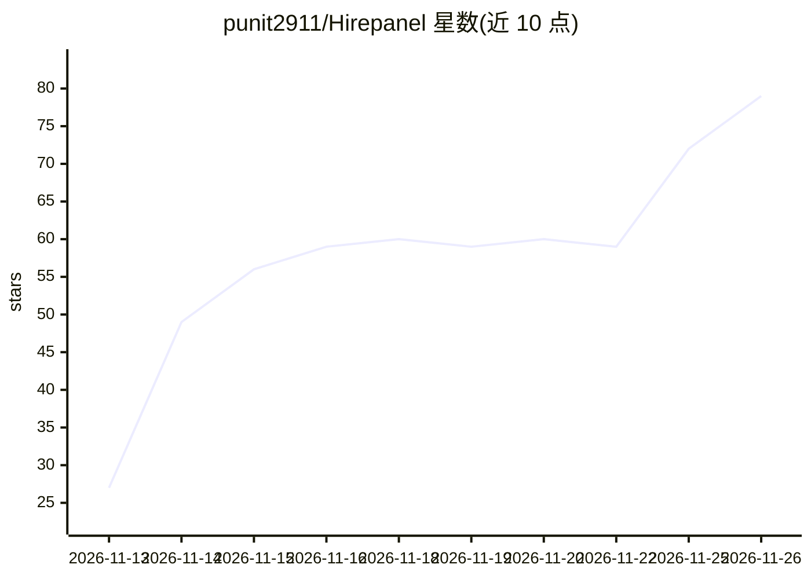

# punit2911/Hirepanel

⭐ 79 · Python · MIT · 推送 2026-11-14 · [GitHub](https://github.com/punit2911/Hirepanel) · [官网](https://hirepanel.onrender.com/) · 个人维护

**多智能体简历筛选系统：每个评分须有简历原文引证**

面向招聘流程的多智能体简历筛选应用：多个评分 agent 分别读简历（严格/宽松两种视角），Evidence Verifier 在文档中搜索引证、剔除编造引用；Shield agent 做提示注入检测，模型读文本前先做盲化脱敏（姓名/联系方式/代词等），最终由人审批后才触发 n8n、Discord 与邮件。默认基于 Ollama 本地模型运行（如 qwen2.5:7b），Gemini/Groq 云端密钥可选，无模型时回退到内置离线规则。README 附带 18 份合成简历的基准测试结果，显示 7B 模型在笔记本上单次调用延迟中位数约 56 秒。

## 筛选速览

| 维度 | 判定 | 备注 |
|---|---|---|
| AI 角色 | `ai-native` | 本体是模型或模型工具 |
| 许可风险 | `permissive` | MIT |
| 部署形态 | `self-host` | docker 或自建部署 |
| 模型依赖 | local-ok | 支持本地模型 |
| 硬件要求 | — | 无带数字的原话,不猜 |
| 安装摩擦 | `low` | 无编译、无系统依赖或容器化 |
| 成熟度 | — | 结构信号不足 |

## 能力要点

- 评分必须附带可在简历中搜索到的原文引证，编造引用不计分并计数
- 提示注入防护、盲化脱敏（含大学名默认脱敏）与偏见审计层
- 默认 Ollama 本地模型运行，云端 Gemini/Groq 可选，全失败时回退离线规则
- 提供 provider 基准脚本（准确率、假引用率、JSON 合法率、延迟）

## 适用场景

- 招聘方对候选人简历做有据可查的初筛排序
- 在本地模型上处理简历，避免简历外发第三方
- 对含注入攻击的简历进行检测并在人工审批后自动通知

## 场景标签

`多智能体` · 领域:Agent 开发

## 证据(README 行号)

> L5: A multi-agent resume screening system where **every score must be backed by a real quote from the resume**.
> L9: **Open-source first.** The scoring agents are built to run on a model you host yourself with Ollama (for example `qw

## 星数曲线

2026-11-13 27 → 2026-11-26 79（+52）

---
*卡片 v1 · prompt 1.4 · 生成 2026-11-18 · 置信度 mid · 依据 README sha `ab8fe3534910` · [字段定义](../../DATASET.md)*
