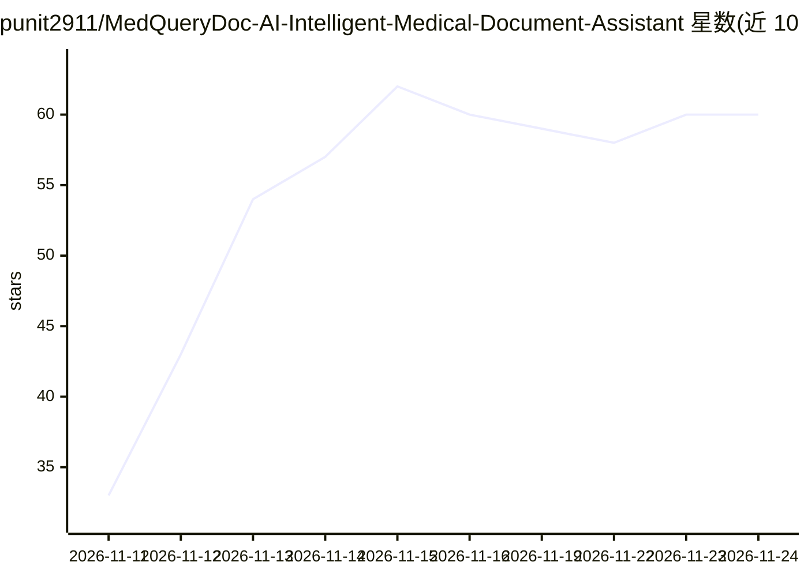

# punit2911/MedQueryDoc-AI-Intelligent-Medical-Document-Assistant

⭐ 60 · Jupyter Notebook · GPL-3.0 · 推送 2026-11-14 · [GitHub](https://github.com/punit2911/MedQueryDoc-AI-Intelligent-Medical-Document-Assistant) · 个人维护

**面向医疗 PDF 文档的 RAG 问答机器人（LLaMA-2+Pinecone）**

基于 Flask 的医疗文档问答应用：加载并切分用户放入 data/ 目录的 PDF，用 Hugging Face 嵌入模型生成向量存入 Pinecone；提问时经相似度检索召回相关片段，由本地运行的量化 LLaMA-2 模型（llama-2-7b-chat.ggmlv3.q4_0.bin）生成回答。需先执行 store_index.py 建索引，再运行 app.py 在 localhost:8080 提供网页界面；需配置 Pinecone API key。项目声明仅供信息与教育用途，非医疗设备。

## 筛选速览

| 维度 | 判定 | 备注 |
|---|---|---|
| AI 角色 | `ai-native` | 本体是模型或模型工具 |
| 许可风险 | `viral` | GPL-3.0 |
| 部署形态 | `library` | 以包/库形式分发 |
| 模型依赖 | — | README 未给出锁定关系 |
| 硬件要求 | — | 无带数字的原话,不猜 |
| 安装摩擦 | `low` | 无编译、无系统依赖或容器化 |
| 成熟度 | — | 结构信号不足 |

## 能力要点

- PDF 切分→Hugging Face 嵌入→Pinecone 向量存储的索引流程
- 本地量化 LLaMA-2 模型推理，无需云端 API
- Flask 网页问答界面
- 两步运行：先 store_index.py 索引，后 app.py 问答

## 适用场景

- 对自己的医学文献或报告 PDF 做自然语言问答
- 学习 LLM+LangChain+向量数据库的 RAG 实践实现
- 作为可扩展的文档问答项目基础进一步开发

## 场景标签

`文档问答` · 领域:知识与检索

## 证据(README 行号)

> L17: This project is an AI-powered **medical document question-answering system** built using **Large Language Models (L
> L19: The system works by loading and splitting PDF documents into smaller chunks, generating vector embeddings using a H

## 星数曲线

2026-11-11 33 → 2026-11-24 60（+27）

---
*卡片 v1 · prompt 1.4 · 生成 2026-11-18 · 置信度 high · 依据 README sha `bb932ced1a03` · [字段定义](../../DATASET.md)*
