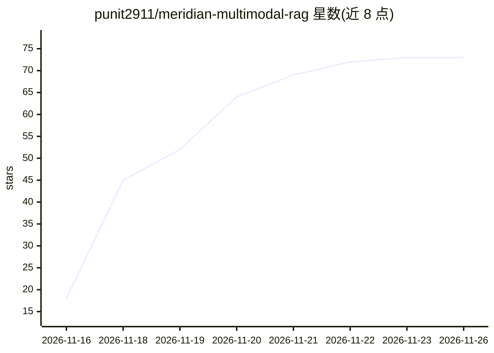

# punit2911/meridian-multimodal-rag

⭐ 73 · Python · MIT · 推送 2026-11-17 · [GitHub](https://github.com/punit2911/meridian-multimodal-rag) · 个人维护

**工业维护文档多模态 RAG 系统：带引用、逐声明验证与拒答**

面向工业维护文档（PDF 手册、扫描件、Word 公告、CSV/XLSX 维护日志、照片）的问答应用：布局感知解析（表格逐行分块、警告、图表数值数字化、OCR），8 路检索通道加权 RRF 加重排，回答逐条引用到页面区域并经声明级幻觉验证（单位感知数字、标识符、否定、引用），支持出处感知冲突消解（公告优先于手册）与证据不足时拒答。默认确定性离线模式，无需 API key、GPU 或模型下载；可配置工具型 LLM 代理（Anthropic 或任意 OpenAI 兼容服务，含本地 Ollama），其输出仍过同一验证器，失败回落离线组合器。含基准评测与 42 项测试，Docker Compose 部署内含 Tesseract 与自托管 Qdrant。

## 筛选速览

| 维度 | 判定 | 备注 |
|---|---|---|
| AI 角色 | `ai-native` | 本体是模型或模型工具 |
| 许可风险 | `permissive` | MIT |
| 部署形态 | `self-host` | docker 或自建部署 |
| 模型依赖 | local-ok | 支持本地模型 |
| 硬件要求 | — | 无带数字的原话,不猜 |
| 安装摩擦 | `low` | 无编译、无系统依赖或容器化 |
| 成熟度 | — | 结构信号不足 |

## 能力要点

- 8 路混合检索通道 → 加权 RRF → 晚期交互重排 → MMR
- 声明级幻觉验证（单位感知数字/标识符/否定/引用）与自动修复、CRAG 式拒答
- 默认确定性离线模式：无 API key、无 GPU、无模型下载
- 出处感知冲突消解与假前提检测（公告优先于手册）

## 适用场景

- 维修技师查询设备手册中的扭矩、规格与报警码并获得可点验的页面引用
- 维护日志 CSV/XLSX 的精确 pandas 分析问答
- 手册与公告数值冲突或问题超出语料时获得明确判定/拒答而非混淆回答

## 场景标签

`RAG` `文档问答` `多模态` · 领域:知识与检索

## 证据(README 行号)

> L3: Meridian answers questions about **industrial maintenance documentation**: PDF manuals (text, tables, charts, diagra
> L5: It runs in **deterministic offline mode by default** (no API key, no GPU, no model download). When configured, an op
> L87: The deterministic controller decides whether the evidence is sufficient. With no LLM configured, Meridian composes 

## 星数曲线

2026-11-16 18 → 2026-11-26 73（+55）

---
*卡片 v1 · prompt 1.4 · 生成 2026-11-18 · 置信度 high · 依据 README sha `9c83500bc17f` · [字段定义](../../DATASET.md)*
