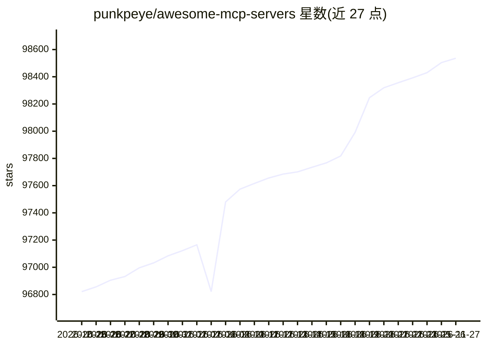

# punkpeye/awesome-mcp-servers

⭐ 98,536 · MIT · 推送 2026-11-26 · [GitHub](https://github.com/punkpeye/awesome-mcp-servers) · [官网](https://glama.ai/mcp/servers) · 个人维护 · 中文 README

**MCP 服务器精选清单：帮开发者查找可扩展 AI 能力的服务器**

Model Context Protocol (MCP) 服务器的策展清单，按 40+ 类别（聚合器、浏览器自动化、数据库、文件系统、编码代理等）组织条目，标注官方实现、编程语言、本地/云部署与操作系统支持。面向需要为 AI 模型接入文件、数据库、API 等资源的开发者。清单限定可自行安装运行的 GitHub 开源服务器，另设客户端清单、远程服务器清单与教程入口，并提供与仓库同步的网页目录。

## 筛选速览

| 维度 | 判定 | 备注 |
|---|---|---|
| AI 角色 | `ai-knowledge` | 知识聚合/清单类 |
| 许可风险 | `permissive` | MIT |
| 部署形态 | `library` | 以包/库形式分发 |
| 模型依赖 | — | README 未给出锁定关系 |
| 硬件要求 | — | 无带数字的原话,不猜 |
| 安装摩擦 | `low` | 无编译、无系统依赖或容器化 |
| 成熟度 | — | 结构信号不足 |

## 动量与使用信号

- 维护:`active` — 距上次 push 3.0 天,年发版 0,443 位贡献者
- 涨星:近 1 天 **+88**(自 20261016 起算)
- 平台:WINDOWS / MACOS / LINUX / WEB · 协议:OPENAI-API / MCP / OLLAMA

## 能力要点

- 按 40+ 类别组织的大量 MCP 服务器条目
- 图例标注编程语言、本地/云范围与操作系统支持
- 与仓库同步的 web 目录
- 提供教程、客户端清单与社区入口（Discord/Subreddit）

## 适用场景

- 为 AI 客户端寻找接入数据库或文件系统的 MCP 服务器
- 按编程语言筛选想部署的 MCP 服务器实现
- 区分本地与云端部署方式的 MCP 服务器选型

## 场景标签

`精选清单` · 领域:学习与行业

## 证据(README 行号)

> L18: A curated list of awesome Model Context Protocol (MCP) servers.
> L24: MCP is an open protocol that enables AI models to securely interact with local and remote resources through standar
> L69: ## Server Implementations

## 星数曲线

2026-10-25 96,821 → 2026-11-27 98,536（+1,715）

---
*卡片 v1 · prompt 1.4 · 生成 2026-11-27 · 置信度 mid · 依据 README sha `0cf91f646556` · [字段定义](../../DATASET.md)*
