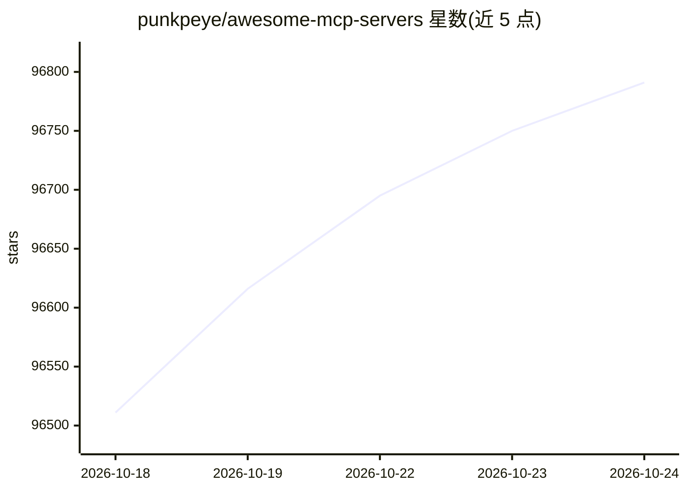

# punkpeye/awesome-mcp-servers

⭐ 96,791 · MIT · 推送 2026-10-23 · [GitHub](https://github.com/punkpeye/awesome-mcp-servers) · [官网](https://glama.ai/mcp/servers) · 个人维护 · 中文 README

**MCP 服务器策展清单：收录可自托管的服务器实现**

punkpeye 维护的 Model Context Protocol (MCP) 服务器策展清单，收录带 GitHub 仓库、需用户自行安装运行的服务器实现，另有配套的远程服务器清单。条目按 50 余个类别组织（聚合器、数据库、浏览器自动化、生物信息、编码代理等），并用图例标注官方实现、编程语言、云/本地范围与操作系统。清单附教程、社区入口，并有与仓库同步的 web 目录。README 提供多语言版本（含简体/繁体中文）。

## 筛选速览

| 维度 | 判定 | 备注 |
|---|---|---|
| AI 角色 | `ai-knowledge` | 知识聚合/清单类 |
| 许可风险 | `permissive` | MIT |
| 部署形态 | `library` | 以包/库形式分发 |
| 模型依赖 | — | README 未给出锁定关系 |
| 硬件要求 | — | 无带数字的原话,不猜 |
| 安装摩擦 | `low` | 无编译、无系统依赖或容器化 |
| 成熟度 | — | 结构信号不足 |

## 动量与使用信号

- 维护:`active` — 距上次 push 3.0 天,年发版 0,443 位贡献者
- 涨星:近 1 天 **+88**(自 20261016 起算)
- 平台:WINDOWS / MACOS / LINUX / WEB · 协议:OPENAI-API / MCP / OLLAMA

## 能力要点

- 按 50+ 类别组织的 MCP 服务器条目
- 图例标注官方实现、语言、云/本地、操作系统
- 配套远程服务器清单与同步的 web 目录
- 含教程与社区入口（Discord/Subreddit）

## 适用场景

- 为 MCP 客户端查找可自托管的服务器实现
- 按类别浏览 MCP 生态覆盖的工具与数据源
- 查找 MCP 入门教程与客户端清单

## 场景标签

`精选清单` · 领域:学习与行业

## 证据(README 行号)

> L16: A curated list of awesome Model Context Protocol (MCP) servers.
> L22: MCP is an open protocol that enables AI models to securely interact with local and remote resources through standar

## 星数曲线

2026-10-18 96,511 → 2026-10-24 96,791（+280）

---
*卡片 v1 · prompt 1.4 · 生成 2026-10-20 · 置信度 high · 依据 README sha `c850a8aa139e` · [字段定义](../../DATASET.md)*
