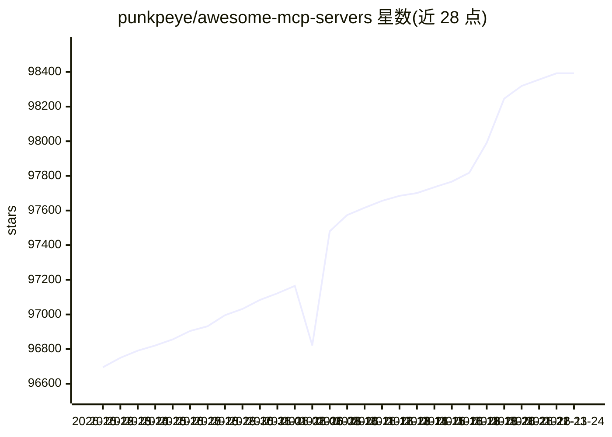

# punkpeye/awesome-mcp-servers

⭐ 98,430 · MIT · 推送 2026-11-23 · [GitHub](https://github.com/punkpeye/awesome-mcp-servers) · [官网](https://glama.ai/mcp/servers) · 个人维护

**MCP 服务器策展清单：按 40+ 类别收录自托管实现**

收录 Model Context Protocol (MCP) 服务器实现的策展清单。MCP 是使 AI 模型通过标准化服务器与本地/远程资源交互的开放协议，条目覆盖文件访问、数据库连接、API 集成等场景。按聚合器、浏览器自动化、数据库、知识记忆等 40+ 类别组织，用图标标注实现语言（Python/TypeScript/Go/Rust 等）、部署范围（本地/云）与支持操作系统，并区分官方实现。另提供客户端清单、教程链接与同步的网页版目录，收录范围为可自行安装运行的 GitHub 开源服务器。

## 筛选速览

| 维度 | 判定 | 备注 |
|---|---|---|
| AI 角色 | `ai-knowledge` | 知识聚合/清单类 |
| 许可风险 | `permissive` | MIT |
| 部署形态 | `library` | 以包/库形式分发 |
| 模型依赖 | — | README 未给出锁定关系 |
| 硬件要求 | — | 无带数字的原话,不猜 |
| 安装摩擦 | `low` | 无编译、无系统依赖或容器化 |
| 成熟度 | — | 结构信号不足 |

## 动量与使用信号

- 维护:`active` — 距上次 push 3.0 天,年发版 0,443 位贡献者
- 涨星:近 1 天 **+88**(自 20261016 起算)
- 平台:WINDOWS / MACOS / LINUX / WEB · 协议:OPENAI-API / MCP / OLLAMA

## 能力要点

- 按 40+ 类别组织的 MCP 服务器条目
- 图标标注语言、本地/云范围、操作系统与官方实现
- 提供客户端清单、教程与网页版同步目录
- 多语言 README（含简繁中文、日韩等）

## 适用场景

- 为 AI 应用查找接入数据库、文件系统或外部 API 的 MCP 服务器
- 按语言或部署方式筛选可自托管的 MCP 实现
- 查找 MCP 相关的入门教程与客户端列表

## 场景标签

`精选清单` · 领域:学习与行业

## 证据(README 行号)

> L18: A curated list of awesome Model Context Protocol (MCP) servers.
> L24: MCP is an open protocol that enables AI models to securely interact with local and remote resources through standar
> L69: ## Server Implementations

## 星数曲线

2026-10-22 96,695 → 2026-11-24 98,392（+1,697）

---
*卡片 v1 · prompt 1.4 · 生成 2026-11-22 · 置信度 mid · 依据 README sha `585c8ee1cde2` · [字段定义](../../DATASET.md)*
