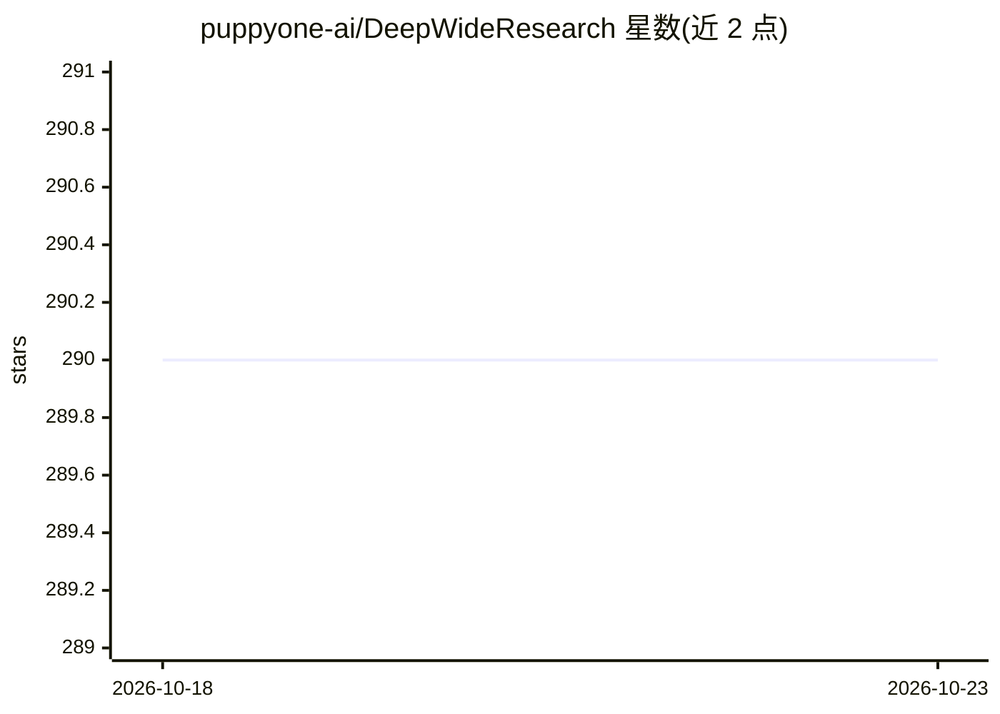

# puppyone-ai/DeepWideResearch

⭐ 290 · TypeScript · Apache-2.0 · 推送 2026-07-12 · [GitHub](https://github.com/puppyone-ai/DeepWideResearch) · [官网](https://www.deepwideresearch.com) · 组织维护

**可调深度与广度的开源 Agentic RAG 研究代理**

基于 MCP 协议的 Agentic RAG 应用，以 Deep（推理深度）× Wide（信息广度）两个维度控制每次研究的范围、响应时间与成本，成本可由设置预测。支持接入自定义数据源、OpenRouter 等模型通道及 Tavily/Exa 搜索，可自托管，后端可单独作为 API 嵌入，或搭配 Next.js 聊天界面部署全栈。需要 Python 3.9+ 与 Node.js 18+，提供 docker-compose 生产部署方式，采用 Apache 2.0 许可。

## 筛选速览

| 维度 | 判定 | 备注 |
|---|---|---|
| AI 角色 | `ai-native` | 本体是模型或模型工具 |
| 许可风险 | `permissive` | Apache-2.0 |
| 部署形态 | `self-host` | docker 或自建部署 |
| 模型依赖 | locked-api |  |
| 硬件要求 | — | 无带数字的原话,不猜 |
| 安装摩擦 | `low` | 无编译、无系统依赖或容器化 |
| 成熟度 | — | 结构信号不足 |

## 能力要点

- Deep × Wide 双维度控制推理深度与信息广度
- MCP 协议原生支持，可接入任意合规数据源或工具
- Tavily 与 Exa 搜索开箱即用，模型可热切换（OpenAI/Claude/私有 LLM）
- 可仅部署后端 API 或前后端全栈，docker-compose 生产部署

## 适用场景

- 搭建可控制研究深度与成本的自托管深度研究助手
- 为客服、市场调研、企业分析等不同场景调节 RAG 策略
- 将 Deep Research 后端作为 API 嵌入自己的代码库

## 场景标签

`RAG` `科研工具` · 领域:知识与检索

## 证据(README 行号)

> L18:  Agentic RAG for any scenario Customize sources, depth, and width
> L76: - **MCP Protocol Native Support** – Built on the Model Context Protocol for seamless integration with any compliant

## 星数曲线

2026-10-18 290 → 2026-10-23 290（+0）

---
*卡片 v1 · prompt 1.4 · 生成 2026-10-22 · 置信度 high · 依据 README sha `f5de0461463a` · [字段定义](../../DATASET.md)*
