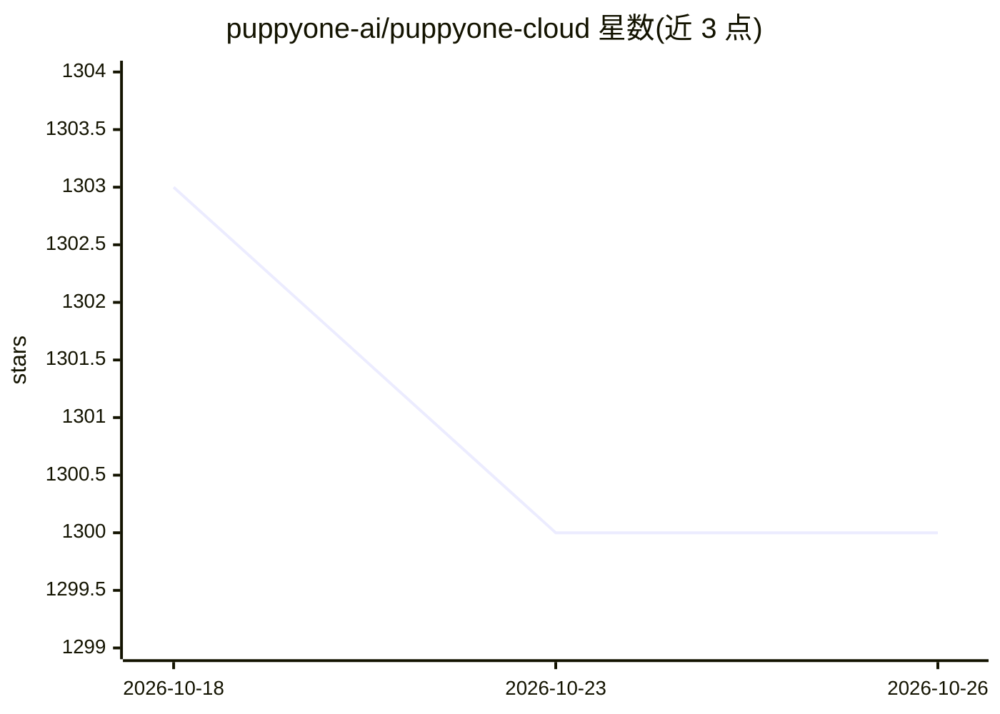

# puppyone-ai/puppyone-cloud

⭐ 1,300 · Python · Apache-2.0 · 推送 2026-10-25 · [GitHub](https://github.com/puppyone-ai/puppyone-cloud) · [官网](https://www.puppyone.ai) · 组织维护

**面向 AI agent 的 Git 原生上下文托管平台**

Puppyone 提供供 AI agent 使用的上下文托管：以 Git 版本控制与文件级权限（FLS）为核心，将 GitHub、Gmail、Google Drive、网页、Supabase 等来源的数据转换为 Markdown/JSON 等 agent 友好格式，存入共享的 Context Drive。每个 agent 通过 MCP 端点、沙箱、REST API、CLI、SSH 等受限 Access Point 访问。提供 Cloud 托管与 Docker 自托管两种部署方式，自托管包含 PostgreSQL 17、Redis、MinIO 等完整栈；agent 聊天需自行配置 ANTHROPIC_API_KEY。

## 筛选速览

| 维度 | 判定 | 备注 |
|---|---|---|
| AI 角色 | `ai-ecosystem` | LLM/agent 周边工具 |
| 许可风险 | `permissive` | Apache-2.0 |
| 部署形态 | `self-host` | docker 或自建部署 |
| 模型依赖 | — | README 未给出锁定关系 |
| 硬件要求 | — | 无带数字的原话,不猜 |
| 安装摩擦 | `low` | 无编译、无系统依赖或容器化 |
| 成熟度 | — | 结构信号不足 |

## 能力要点

- Git 版本控制、文件级版本历史与一键回滚
- 文件级安全（FLS）：agent 无权限的文件在其环境中物理不存在
- 内置 GitHub/Gmail/Google Drive 等十余种数据源连接器
- 通过 MCP、沙箱、REST API、CLI 等多种 Access Point 供 agent 访问

## 适用场景

- 为多个 AI agent 提供统一的、带版本管理的上下文存储
- 按 agent 分配不同的文件访问权限并留存审计日志
- 让 Cursor、Claude Desktop 等 MCP 客户端读取我的 Context Drive

## 场景标签

`Agent 记忆` · 领域:Agent 开发

## 证据(README 行号)

> L6:  Puppyone provides context hosting for AI agents, with Git version control and file-level scoped permissions for eve
> L17: It supports CLI, MCP, Git, bash/SSH, and web app interactions through Access Points for different AI agents.

## 星数曲线

2026-10-18 1,303 → 2026-10-26 1,300（-3）

---
*卡片 v1 · prompt 1.4 · 生成 2026-10-21 · 置信度 high · 依据 README sha `baa576a51b18` · [字段定义](../../DATASET.md)*
