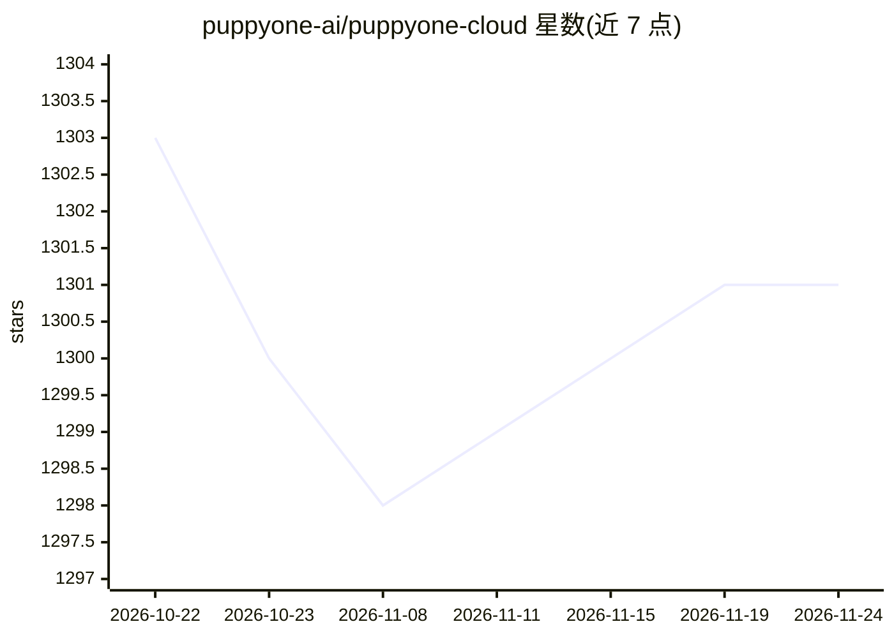

# puppyone-ai/puppyone-cloud

⭐ 1,302 · Python · Apache-2.0 · 推送 2026-11-23 · [GitHub](https://github.com/puppyone-ai/puppyone-cloud) · [官网](https://www.puppyone.ai) · 组织维护

**托管 agent 项目为 Git 仓库的团队云基础设施**

puppyone 的云端基础设施，把项目作为真实 Git 仓库托管，使团队与 agent 可通过 Web 应用、Git、MCP、CLI 或 REST API 访问，所有写入经同一版本引擎发布到 PostgreSQL 与 S3，可回滚。提供组织、角色、邀请与审计日志，并支持在云中运行 agent 的托管工作区（Early Access）。本仓库包含 API、Web 应用、版本引擎与数据库迁移，可用 Docker 自托管；本地 Docker 栈默认含账户与文件读写，上传管线、导入源、MCP 与 agent 运行需额外的后端进程。

## 筛选速览

| 维度 | 判定 | 备注 |
|---|---|---|
| AI 角色 | `ai-ecosystem` | LLM/agent 周边工具 |
| 许可风险 | `permissive` | Apache-2.0 |
| 部署形态 | `self-host` | docker 或自建部署 |
| 模型依赖 | — | README 未给出锁定关系 |
| 硬件要求 | — | 无带数字的原话,不猜 |
| 安装摩擦 | `low` | 无编译、无系统依赖或容器化 |
| 成熟度 | `idea` | |

## 能力要点

- 每个云项目是标准 Git 仓库，原生 git 客户端即可克隆/推送
- Web、Git、MCP、CLI、REST 多入口经同一版本引擎发布，历史一致可回滚
- 每条 MCP/Git/CLI 连接有独立凭据，可暂停或吊销
- 托管工作区支持合盖后 agent 继续运行（Early Access）

## 适用场景

- 让团队和 agent 在云端协作同一份项目代码与文件
- 为每个接入 agent 发放可独立吊销的凭据
- 自托管一套带审计与回滚的项目托管服务
- 把 GitHub、Gmail、Google Drive 等来源接入项目

## 场景标签

 · 领域:AI 基础设施/项目托管

## 证据(README 行号)

> L6:  Hosts your projects as Git repositories, keeps them online, and controls which people and agents can reach them.
> L13: puppyone is the folder your agents live in. It runs on your computer and needs no account. Cloud is the optional pa
> L17: This repository contains that infrastructure: the API, the Cloud web app, the version engine and the database migra

## 星数曲线

2026-10-22 1,303 → 2026-11-24 1,301（-2）

---
*卡片 v1 · prompt 1.4 · 生成 2026-11-23 · 置信度 high · 依据 README sha `c8a5c94caf98` · [字段定义](../../DATASET.md)*
