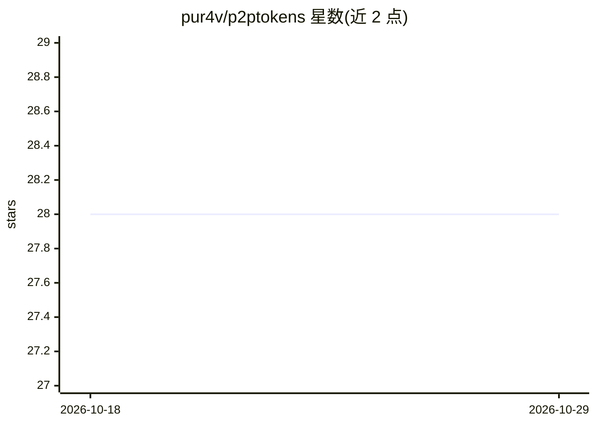

# pur4v/p2ptokens

⭐ 28 · Rust · 推送 2026-07-15 · [GitHub](https://github.com/pur4v/p2ptokens) · 个人维护

**P2P 去中心化 LLM 推理网络：节点互相共享算力与补全**

用 Rust + libp2p 实现的对等网络：单个二进制既是推理服务提供方（seeder）也是消费方（leecher），接入访问以上传/下载比例（BitTorrent 式 barter ratio）计量，配合签名 co-receipts 防作弊、内容盲协调器不接触推理数据。后端可接 Ollama、任意 OpenAI 兼容端点（vLLM/llama.cpp 等）或 Claude；提供 OpenAI 兼容 /v1 端点、嵌入式聊天 UI、Tauri 桌面应用与 NAT 穿透。限制：v1 协调器状态在内存中（单实例无 DB），服务节点以明文看到 prompt，无 TEE/沙箱，README 自述仅适合非敏感负载。

## 筛选速览

| 维度 | 判定 | 备注 |
|---|---|---|
| AI 角色 | `ai-ecosystem` | LLM/agent 周边工具 |
| 许可风险 | `permissive` | — |
| 部署形态 | `desktop` | 安装包/桌面程序 |
| 模型依赖 | local-ok | 支持本地模型 |
| 硬件要求 | — | 无带数字的原话,不猜 |
| 安装摩擦 | `low` | 无编译、无系统依赖或容器化 |
| 成熟度 | `idea` | |

## 能力要点

- 上传/下载比例计量 + 签名 co-receipts 反作弊，双方谎报不超一个 chunk
- 内容盲协调器：只撮合不接触推理数据，数据面直连 P2P
- OpenAI 兼容 /v1 端点与嵌入式聊天 UI（流式、本地 SQLite 历史）
- single/racing/quorum/ensemble 四种 fan-out 模式与自动 seeder 故障转移

## 适用场景

- 让闲置 GPU 的 Ollama/兼容端点向其他节点供数，换取推理额度
- 通过 OpenAI 兼容端点从 P2P 网络获取推理补全
- 企业用一份配置 fork 自建私有、白标的推理 swarm

## 场景标签

`推理引擎` · 领域:训练与推理

## 证据(README 行号)

> L5: **Distributed, decentralized LLM inference across a peer-to-peer swarm** — one
> L22: inference**. Run one app; it *seeds* completions from a model you already run
> L23: (Ollama, any OpenAI-compatible endpoint, or Claude) and *leeches* completions
> L115: drop-in **`/v1` endpoint** — point any OpenAI-compatible client at

## 星数曲线

2026-10-18 28 → 2026-10-29 28（+0）

---
*卡片 v1 · prompt 1.4 · 生成 2026-10-26 · 置信度 high · 依据 README sha `3c8c534ebe8b` · [字段定义](../../DATASET.md)*
