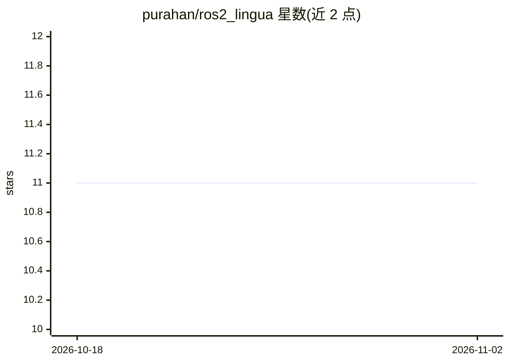

# purahan/ros2_lingua

⭐ 11 · C++ · Apache-2.0 · 推送 2026-09-24 · [GitHub](https://github.com/purahan/ros2_lingua) · [官网](https://purahan.github.io/ros2_lingua/) · 个人维护

**把自然语言指令接地为 ROS 2 机器人执行计划的 LLM 库**

面向机器人开发者的 ROS 2 库：节点通过 capability schema 自描述能力，grounding 引擎将自然语言指令经 LLM 翻译为经过校验、依赖感知的 ActionPlan，再经 DispatcherNode 分发到现有 ROS 2 actions/services 执行。反向链式规划器自动解析能力前置依赖，LLM 建议在派发前对照注册能力表校验以防幻觉。LLM 后端可切换（Ollama/OpenAI/Anthropic/自定义），核心层零 ROS 依赖可独立测试，另含 header-only C++ 包与 mock 仿真栈。需 ROS 2 Humble 与至少一个 LLM 后端。

## 筛选速览

| 维度 | 判定 | 备注 |
|---|---|---|
| AI 角色 | `ai-ecosystem` | LLM/agent 周边工具 |
| 许可风险 | `permissive` | Apache-2.0 |
| 部署形态 | `None` |  |
| 模型依赖 | local-ok | 支持本地模型 |
| 硬件要求 | — | 无带数字的原话,不猜 |
| 安装摩擦 | `low` | 无编译、无系统依赖或容器化 |
| 成熟度 | — | 结构信号不足 |

## 能力要点

- 结构化 capability schema：节点声明能力，LLM 建议派发前校验
- 反向链式规划器自动解析能力依赖，无需硬编码执行序列
- LLM 后端可切换：Ollama（本地无需 key）/OpenAI/Anthropic/自定义
- 核心层零 ROS 2 依赖（80 个测试约 0.2s），含 mock 仿真栈与 web 仪表盘

## 适用场景

- 让 ROS 2 机器人通过自然语言指令执行任务
- 在真实硬件上运行前校验 LLM 生成的行动计划
- 无真机环境下用 mock 栈演示和开发自然语言控制
- 多机器人命名空间下各自独立接收自然语言指令

## 场景标签

 · 领域:机器人/LLM 应用基础设施

## 证据(README 行号)

> L16: `ros2_lingua` is a ROS 2 library that bridges the gap between large language models (LLMs) and real robot control. 
> L43: - **LLM-agnostic**: works with OpenAI, Anthropic Claude, local Ollama models, or any custom backend you implement

## 星数曲线

2026-10-18 11 → 2026-11-02 11（+0）

---
*卡片 v1 · prompt 1.4 · 生成 2026-11-01 · 置信度 high · 依据 README sha `67927f745685` · [字段定义](../../DATASET.md)*
