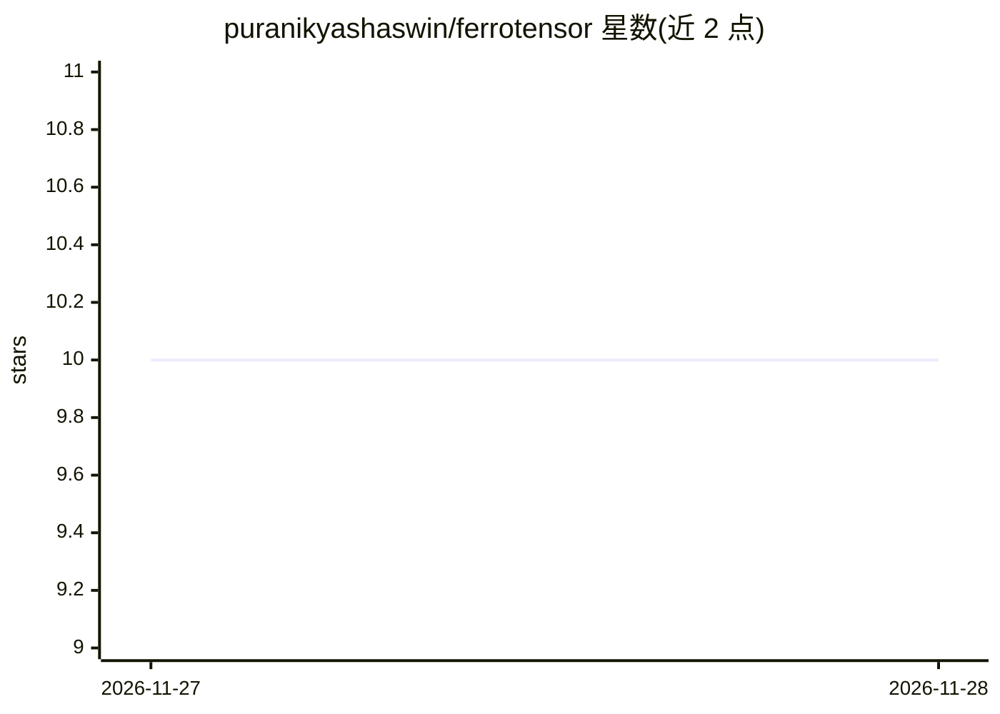

# puranikyashaswin/ferrotensor

⭐ 10 · Rust · Apache-2.0 · 推送 2026-11-27 · [GitHub](https://github.com/puranikyashaswin/ferrotensor) · [官网](https://ferrotensor.dev) · 个人维护

**纯 Rust GPU 张量/autograd/LoRA 微调框架，无 CUDA 无 Python**

基于 wgpu 与手写 WGSL 计算内核的纯 Rust 机器学习框架，提供张量运算、反向模式 autograd 与 Llama 风格小模型的 LoRA 微调，经 Vulkan、Metal 或 DX12 运行，CPU 设备可用作参考路径。附 CLI 覆盖 info/plan/finetune/chat/merge/export-gguf/pretrain 流程，梯度与损失在 CI 中对照 PyTorch 校验。声明 pre-1.0、单一维护者、多数训练路径为 Experimental，LoRA 微调仅在少数 GPU 上实测。

## 筛选速览

| 维度 | 判定 | 备注 |
|---|---|---|
| AI 角色 | `ai-native` | 本体是模型或模型工具 |
| 许可风险 | `permissive` | Apache-2.0 |
| 部署形态 | `library` | 以包/库形式分发 |
| 模型依赖 | local-ok | 支持本地模型 |
| 硬件要求 | — | 无带数字的原话,不猜 |
| 安装摩擦 | `medium` | 含编译或系统依赖之一 |
| 成熟度 | `idea` | |

## 能力要点

- 张量、autograd、LoRA 微调经 wgpu 运行于 Vulkan/Metal/DX12
- CLI 从显存估算到微调、合并、GGUF 导出的一条命令流水线
- 梯度与损失在 CI 中对照 PyTorch autograd 校验（容差 1e-4 + 1e-3×|期望|）
- 提供 Rust crate 与 PyTorch 风格 Python 绑定

## 适用场景

- 在没有 CUDA 的 GPU（如 Apple Silicon）上对 Llama 风格小模型做 LoRA 微调
- 从源码逐层阅读和修改从 API 到 shader 的机器学习实现
- 导出 GGUF 供 llama.cpp/Ollama 加载推理

## 场景标签

`微调` `推理引擎` · 领域:训练与推理

## 证据(README 行号)

> L3:  A pure-Rust GPU ML framework: no CUDA, no Python, no C++ toolchain.
> L14: Ferrotensor (Ferro Tensor) runs tensors, autograd and LoRA fine-tuning of
> L16: hand-written WGSL compute kernels, which run through Vulkan, Metal or DX12.

## 星数曲线

2026-11-27 10 → 2026-11-28 10（+0）

---
*卡片 v1 · prompt 1.4 · 生成 2026-11-27 · 置信度 high · 依据 README sha `c535f625b771` · [字段定义](../../DATASET.md)*
