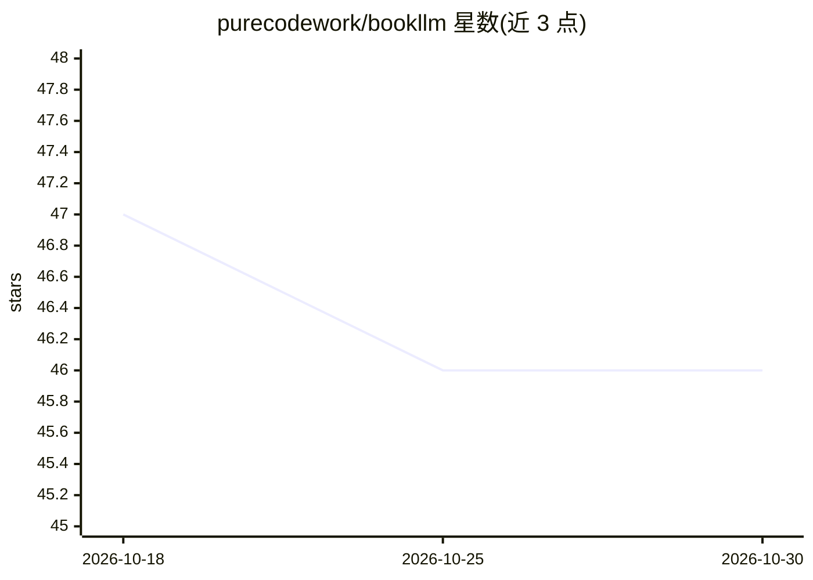

# purecodework/bookllm

⭐ 46 · TypeScript · MIT · 推送 2026-10-11 · [GitHub](https://github.com/purecodework/bookllm) · 组织维护 · 中文 README

**自托管书籍翻译应用：双语阅读、术语表、审校与润色流水线**

面向长文阅读与翻译的自托管 Web 应用：上传 EPUB/PDF/TXT 后由 LLM 翻译，流式输出到双语阅读界面。支持 OpenAI 兼容端点与本地运行时（Ollama、LM Studio、OMLX 等），翻译流程含可选的术语表抽取、审校、润色多阶段流水线，可用 Sidekick 第二模型承担质量环节；内置 PDF 文本抽取与扫描页 OCR。通过 Docker Compose 部署，后端为 NestJS + PostgreSQL，界面提供 8 种语言互译与源语言自动检测。README 提示多阶段流水线会显著增加 token 消耗与耗时，建议先小样测试。

## 筛选速览

| 维度 | 判定 | 备注 |
|---|---|---|
| AI 角色 | `ai-native` | 本体是模型或模型工具 |
| 许可风险 | `permissive` | MIT |
| 部署形态 | `self-host` | docker 或自建部署 |
| 模型依赖 | local-ok | 支持本地模型 |
| 硬件要求 | — | 无带数字的原话,不猜 |
| 安装摩擦 | `low` | 无编译、无系统依赖或容器化 |
| 成熟度 | — | 结构信号不足 |

## 能力要点

- 双语长文阅读界面，翻译流式实时输出
- 可选术语表抽取、审校、润色多阶段流水线，支持 Sidekick 第二模型
- 兼容 OpenAI、DeepSeek、OpenRouter、Ollama、LM Studio、OMLX 等端点
- PDF 文本抽取与捆绑 OCR 处理扫描页

## 适用场景

- 用本地或云端 LLM 翻译整本电子书并双语对照阅读
- 维护全书术语一致性并让第二模型审校润色
- 翻译扫描版 PDF 资料

## 场景标签

`OCR` · 领域:感知与多模态

## 证据(README 行号)

> L13: BookLLM is a self-hosted book translation app with glossary, review, and polish pipelines.
> L21:  Bilingual long-form reading with live translation output.

## 星数曲线

2026-10-18 47 → 2026-10-30 46（-1）

---
*卡片 v1 · prompt 1.4 · 生成 2026-10-25 · 置信度 high · 依据 README sha `b064be861fdd` · [字段定义](../../DATASET.md)*
