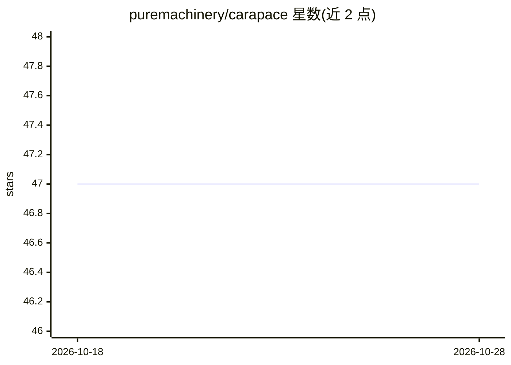

# puremachinery/carapace

⭐ 47 · Rust · Apache-2.0 · 推送 2026-10-27 · [GitHub](https://github.com/puremachinery/carapace) · [官网](https://getcara.io/) · 组织维护

**本地优先的个人 AI 助手，注重安全，多渠道多模型接入**

用 Rust 编写的开源自托管个人 AI 助手，运行在用户本机，通过 Matrix、Signal、Telegram、Discord、Slack、webhooks 与控制台交互。LLM 引擎接入 Anthropic、OpenAI、Codex、Ollama、Gemini、Vertex AI、Bedrock、NEAR AI Cloud、Venice AI 及本地 Claude CLI，以 provider:model 字符串显式路由模型。安全机制包括默认 localhost 绑定、OS 凭据存储加密、Ed25519 签名的 WASM 插件沙箱、提示注入防护与 OS 级子进程沙箱。安装为发行版二进制 cara，Apache-2.0 许可。

## 筛选速览

| 维度 | 判定 | 备注 |
|---|---|---|
| AI 角色 | `ai-native` | 本体是模型或模型工具 |
| 许可风险 | `permissive` | Apache-2.0 |
| 部署形态 | `None` |  |
| 模型依赖 | local-ok | 支持本地模型 |
| 硬件要求 | — | 无带数字的原话,不猜 |
| 安装摩擦 | `low` | 无编译、无系统依赖或容器化 |
| 成熟度 | — | 结构信号不足 |

## 能力要点

- 11 种 LLM 提供商接入与 provider:model 显式路由
- 7 种消息渠道（Matrix/Signal/Telegram/Discord/Slack/console/webhooks）
- 签名验证的 WASM 插件运行时与资源限制
- 针对提示注入、SSRF、供应链等威胁的默认防御（表格列出）

## 适用场景

- 在本机自托管一个跨 IM 渠道的 AI 助手
- 通过 Ollama 等本地模型实现本地优先的私密对话
- 用沙箱化插件与受控文件系统工具扩展助手能力

## 场景标签

`AI 助手` `聊天机器人` · 领域:对话与助手

## 证据(README 行号)

> L5: A security-focused, open-source personal AI assistant. Runs on your machine. Works through Matrix, Signal, Telegram,
> L11: - **Multi-provider LLM engine** — Anthropic, OpenAI API key, Codex subscription login, Ollama, Google Gemini, Verte

## 星数曲线

2026-10-18 47 → 2026-10-28 47（+0）

---
*卡片 v1 · prompt 1.4 · 生成 2026-10-25 · 置信度 high · 依据 README sha `53eab532715d` · [字段定义](../../DATASET.md)*
