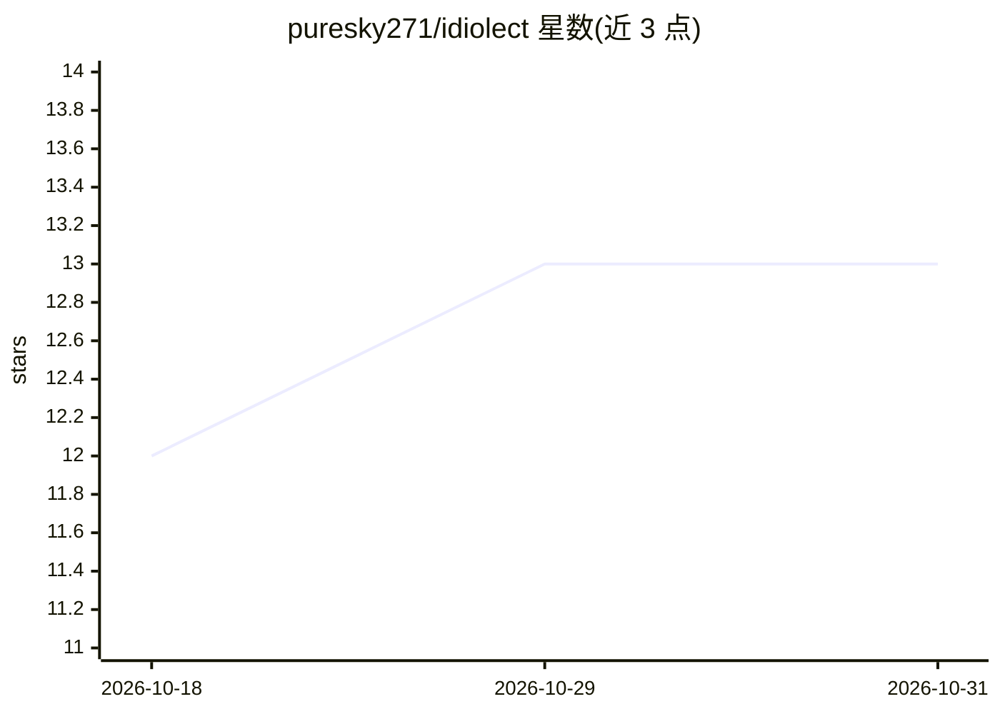

# puresky271/idiolect

⭐ 13 · Python · MIT · 推送 2026-10-13 · [GitHub](https://github.com/puresky271/idiolect) · 个人维护 · 中文 README

**角色扮演说话风格的 prompt 约束框架与可复现评测方法**

从角色原作台词统计说话习惯（句长、句数、口癖、场景差异），写成 prompt 四层硬约束（canon/voice/style_target/turn_logic），不做微调、不含原作文本。附带两轴评测：风格轴（分布贴合、复述审计等）与 grounding 轴（证据合同、11 类任务），全部离线零密钥运行，运行时零第三方依赖。以 Python 库 + CLI + 69 个工具脚本 + 十二篇文档形式提供，示例角色为《BanG Dream! It's MyGO!!!!!》五人，方法可迁移到其他作品。限制：非官方同人项目，Skill 展示不执行动态路由，历史批次仅定性示例。

## 筛选速览

| 维度 | 判定 | 备注 |
|---|---|---|
| AI 角色 | `ai-ecosystem` | LLM/agent 周边工具 |
| 许可风险 | `permissive` | MIT |
| 部署形态 | `library` | 以包/库形式分发 |
| 模型依赖 | — | README 未给出锁定关系 |
| 硬件要求 | — | 无带数字的原话,不猜 |
| 安装摩擦 | `low` | 无编译、无系统依赖或容器化 |
| 成熟度 | — | 结构信号不足 |

## 能力要点

- 四层 prompt 装配（canon/voice/style_target/turn_logic），输出可直接发给模型的 messages
- 风格轴 + grounding 轴双轴评测，离线零密钥，运行时零第三方依赖
- 25 个同链变异体与 9 个健康反控制自检评测链路检出力
- 69 个可换作品工具脚本与五角色现成风格画像（仅聚合数字）

## 适用场景

- 给我的角色卡加上可验证的说话风格约束，避免客服腔
- 对比改 prompt 前后角色扮演是否真的更像了
- 检查角色回答是否被可见证据约束住、有没有编造或泄漏

## 场景标签

`提示工程` `模型评测` · 领域:Agent 开发

## 证据(README 行号)

> L57: |**一个能直接用的装配库**|`pip install .` 之后 `from idiolect.assemble import build_messages` 就能拿到四层 prompt。**运行时零第三方依赖**（探针与蒸馏
> L143: |逐条检查|字数硬上限（与 prompt 里写的是同一个数）、句数上限、越界高危特征、canon 事实、思考标签泄漏|合同校验 → prompt 边界（关键证据是否可见、时态对齐、来源对齐、隐藏值与私有元数据隔离、层序）→ 回复
> L58: |**一套能证明「更像了」的评测**|探针 →（分布贴合 / 同格重复 / 逐字复述）三件套 → 多臂池化 → 功效估算；另有越界拒答与多轮漂移两个专项探针，加上事实一致性门禁。下面那张表就是一次真跑的 105 条回复|

## 星数曲线

2026-10-18 12 → 2026-10-31 13（+1）

---
*卡片 v1 · prompt 1.4 · 生成 2026-10-31 · 置信度 mid · 依据 README sha `025f74773908` · [字段定义](../../DATASET.md)*
