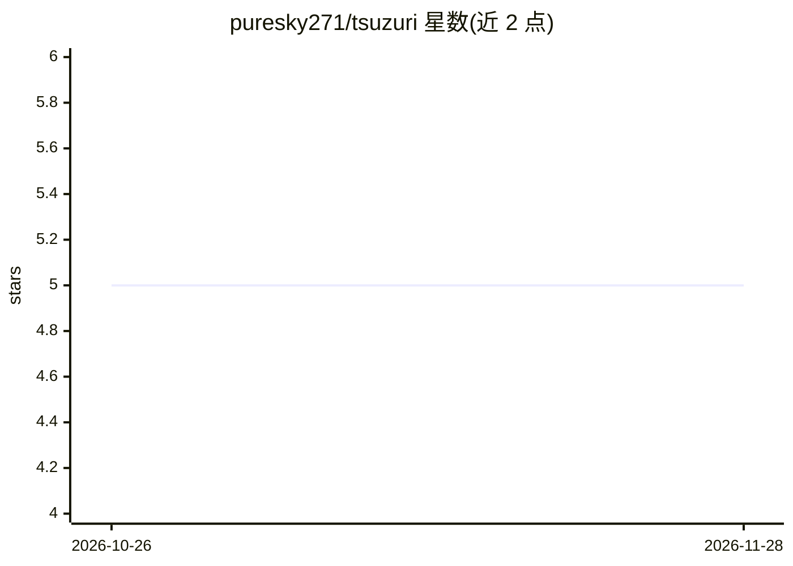

# puresky271/tsuzuri

⭐ 5 · Python · Apache-2.0 · 推送 2026-10-29 · [GitHub](https://github.com/puresky271/tsuzuri) · 个人维护 · 中文 README

**为多角色对话产品提供长期记忆层与上下文编译的 Python 库**

面向多持久角色与单个用户对话的场景，tsuzuri 提供分层记忆（working/episodic/semantic/procedural/collective）、混合召回（FTS5+jieba 关键词、可选稠密向量、ACT-R 式衰减、MMR）、回合事实卡与上下文预算编译，并有离线运行的巩固（consolidation）流程。默认离线规则路径无需 API key；接入任意 OpenAI-compatible 端点后启用 LLM 抽取与回复。当前为 alpha（0.1），仅可从源码安装，API 可能变动；提示词与抽取启发式以中文优先。

## 筛选速览

| 维度 | 判定 | 备注 |
|---|---|---|
| AI 角色 | `ai-ecosystem` | LLM/agent 周边工具 |
| 许可风险 | `permissive` | Apache-2.0 |
| 部署形态 | `library` | 以包/库形式分发 |
| 模型依赖 | — | README 未给出锁定关系 |
| 硬件要求 | — | 无带数字的原话,不猜 |
| 安装摩擦 | `low` | 无编译、无系统依赖或容器化 |
| 成熟度 | `idea` | |

## 能力要点

- 分层记忆与集体作用域：角色私有记忆与共享房间记忆分离，秘密备注不进入共享范围
- 召回融合：FTS5+jieba 关键词通道、可选 bge-small/bge-m3 稠密向量、衰减与 MMR
- 上下文编译器按预算选择、去重并放置回合事实与召回记忆
- 离线默认路径：无需 API key 与下载即可运行 demo 与评估

## 适用场景

- 为陪伴/角色聊天应用添加跨会话的长期记忆
- 让游戏 NPC 群体共享新闻并跨会话记住玩家
- 为多个助手搭建各自记忆加共享团队记忆
- 接入自有聊天栈时仅使用其 build_messages 做上下文组装

## 场景标签

`Agent 记忆` · 领域:Agent 开发

## 证据(README 行号)

> L22: tsuzuri (綴り, "stitching together") is a long-term memory layer and context compiler for products where several pers
> L29: - **Recall**: a recency window, an FTS5 + jieba keyword lane and optional dense vectors, fused with ACT-R style dec

## 星数曲线

2026-10-26 5 → 2026-11-28 5（+0）

---
*卡片 v1 · prompt 1.4 · 生成 2026-11-21 · 置信度 mid · 依据 README sha `e20201eddf1f` · [字段定义](../../DATASET.md)*
