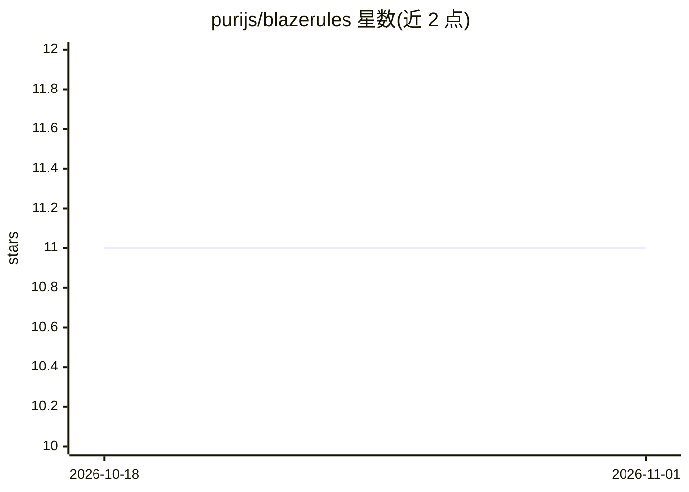

# purijs/blazerules

⭐ 11 · C++ · NOASSERTION · 推送 2026-07-15 · [GitHub](https://github.com/purijs/blazerules) · [官网](https://blazerules.dev) · 个人维护

**SIMD 加速的 C++ 规则引擎，嵌入数据管道评估事件批次**

用 C++ 编写、面向高吞吐事件批次的声明式规则引擎：以 YAML 定义规则，对 NDJSON、Arrow、Parquet、Avro、Protobuf、Kafka、Debezium CDC 等格式的事件批次求值，输出逐条决策与死信记录。提供 Python SDK、原生 CLI、常驻 ingest agent（HTTP/stdin/file_tail）与本地只读 dashboard；内部批量优先，运行时分发 AVX2/AVX-512/NEON 内核。可选注册 ONNX 分类/回归模型供规则内 model_score 调用，预测写入决策日志。以 pip 包和 GitHub Releases 原生归档分发。

## 筛选速览

| 维度 | 判定 | 备注 |
|---|---|---|
| AI 角色 | `ai-enhanced` | 去掉 AI 部分产品仍成立 |
| 许可风险 | `permissive` | NOASSERTION |
| 部署形态 | `library` | 以包/库形式分发 |
| 模型依赖 | — | README 未给出锁定关系 |
| 硬件要求 | — | 无带数字的原话,不猜 |
| 安装摩擦 | `medium` | 含编译或系统依赖之一 |
| 成熟度 | — | 结构信号不足 |

## 能力要点

- YAML 规则对多格式事件批次求值，SIMD/批处理优先引擎
- Python SDK / CLI / 本地 agent / dashboard 四种界面共享同一引擎
- 可从 HTTP、stdin、file tail、Kafka、S3 摄入，支持死信路由
- 规则内可调用 ONNX 分类/回归模型做评分

## 适用场景

- 在事件管道中对支付或日志批次做规则判定与风控评分
- 长期运行 agent 摄取日志流并输出决策日志供下游路由
- 离线对历史数据做规则回测（backtest）

## 场景标签

 · 领域:数据处理/事件流规则引擎

## 证据(README 行号)

> L7: BlazeRules evaluates YAML rules over high-volume event batches. Use it from
> L237: `model_score` conditions call an ONNX model registered by name. Register one or
> L259: Models are scored in parallel across records with NEON/SIMD feature gathering, so

## 星数曲线

2026-10-18 11 → 2026-11-01 11（+0）

---
*卡片 v1 · prompt 1.4 · 生成 2026-11-01 · 置信度 mid · 依据 README sha `d81f8a82bf24` · [字段定义](../../DATASET.md)*
