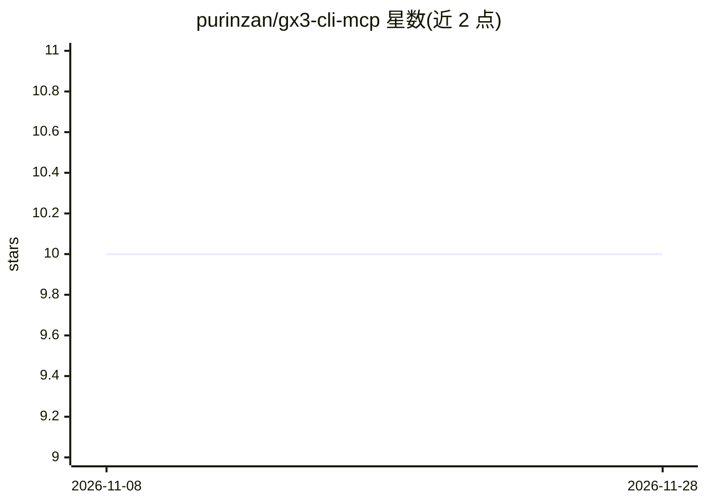

# purinzan/gx3-cli-mcp

⭐ 10 · Python · NOASSERTION · 推送 2026-11-19 · [GitHub](https://github.com/purinzan/gx3-cli-mcp) · [官网](https://zenn.dev/purinzan/articles/gx-works3-ladder-cli-mcp) · 个人维护

**不开 GX Works3 即可分析三菱 PLC 梯形图的只读 CLI + MCP 服务器**

在本地读取三菱 MELSEC 的 .gx3 工程，提供只读静态分析：追查设备读写位置、线圈导通条件、外部输入来源、永假分支（dead-logic）、重复线圈等 lint 问题，并支持版本间 diff 与梯形图 SVG 输出。同一套分析以 stdio MCP 服务器暴露，供 AI agent 基于索引事实回答而非猜测二进制文件。不修改工程、不连接 PLC 写入；live-read 可经 MC Protocol/SLMP 读取实时值。输出仅为参考，需在 GX Works3 中复核。

## 筛选速览

| 维度 | 判定 | 备注 |
|---|---|---|
| AI 角色 | `ai-ecosystem` | LLM/agent 周边工具 |
| 许可风险 | `none` | NOASSERTION |
| 部署形态 | `desktop` | 安装包/桌面程序 |
| 模型依赖 | — | README 未给出锁定关系 |
| 硬件要求 | — | 无带数字的原话,不猜 |
| 安装摩擦 | `low` | 无编译、无系统依赖或容器化 |
| 成熟度 | — | 结构信号不足 |

## 能力要点

- CLI 与 stdio MCP 服务器提供同一套只读分析
- trace-device/interlock-check 追查线圈不导通原因
- dead-logic、lint（重复线圈、多写入者、操作数宽度）等静态检查
- 所有命令支持 --format json 供脚本调用

## 适用场景

- 排查梯形图中某线圈为何始终不导通
- 让 AI agent 基于索引事实回答 PLC 工程相关问题
- 对比两个工程版本之间的语义差异

## 场景标签

`代码审查` · 领域:编码与开发

## 证据(README 行号)

> L18: It is a CLI, and the same analysis is a stdio MCP server, so an AI agent can
> L91:     "gx3": { "command": "gx3-mcp-server" }

## 星数曲线

2026-11-08 10 → 2026-11-28 10（+0）

---
*卡片 v1 · prompt 1.4 · 生成 2026-11-19 · 置信度 high · 依据 README sha `2efc075ad130` · [字段定义](../../DATASET.md)*
