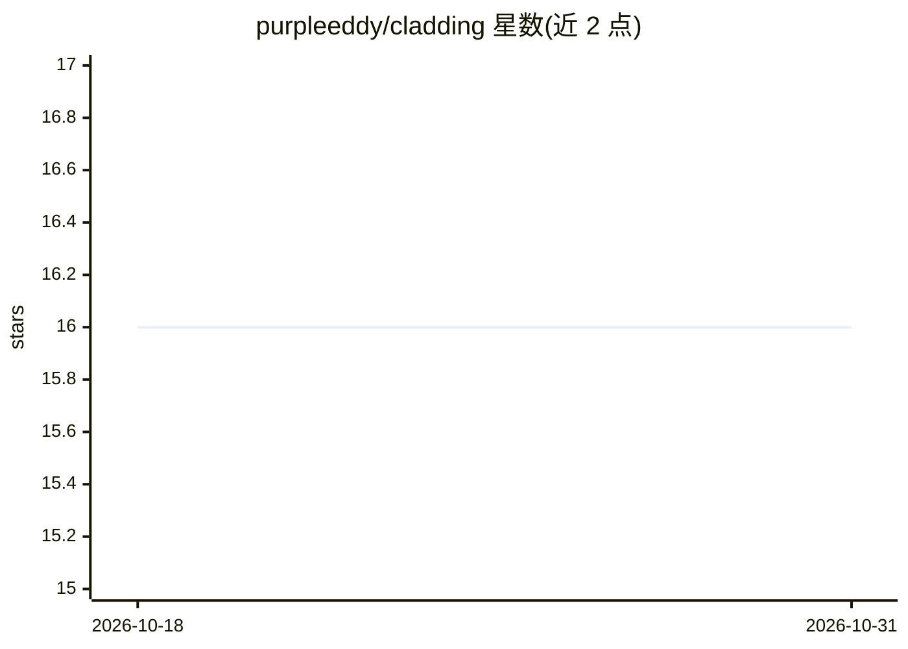

# purpleeddy/cladding

⭐ 16 · TypeScript · MIT · 推送 2026-09-11 · [GitHub](https://github.com/purpleeddy/cladding) · [官网](https://www.npmjs.com/package/cladding) · 个人维护 · 中文 README

**包裹 AI 编码代理的验证层：事前注入意图，事后按 spec 验证**

面向让 AI 写代码的开发者、团队与组织：cladding 包裹宿主 LLM（Claude Code、Codex、Gemini、Antigravity、Cursor），在会话开始前注入项目意图与团队规则，完成后以 15 阶段门禁、41 个漂移检测器和实现盲评 agent 对照 spec 验证，'done' 状态只能通过全部检查获得并留下验证签名。spec 以 git 版本化的四层结构作为项目长期记忆，功能用 hash ID 分片避免冲突，另提供可查询的项目知识图（clad graph）。实时干预在 Claude Code 上运行，其他宿主通过会话内工具调用加 git/CI 门禁实现。

## 筛选速览

| 维度 | 判定 | 备注 |
|---|---|---|
| AI 角色 | `ai-ecosystem` | LLM/agent 周边工具 |
| 许可风险 | `permissive` | MIT |
| 部署形态 | `library` | 以包/库形式分发 |
| 模型依赖 | locked-api |  |
| 硬件要求 | — | 无带数字的原话,不猜 |
| 安装摩擦 | `low` | 无编译、无系统依赖或容器化 |
| 成熟度 | — | 结构信号不足 |

## 能力要点

- 15 阶段验证门禁与 41 个漂移检测器（spec·code·test·docs 多方向）
- 实现盲评 grader：无法读实现、只能对照 spec 检查
- spec 四层结构（intent/design/code/audit）作为项目长期记忆并注入会话
- clad check --json 输出机器可读结果，可驱动 AI loop

## 适用场景

- 让 AI 写代码时以门禁验证代替其自我声明'完成了'
- 团队多人多 AI 从共享 spec 协作并自动捕获漂移与冲突
- 为 AI 自动化 loop 提供可依据的验证信号与诚实停止条件
- 查询项目知识图：改这段代码会影响什么、要跑哪些测试

## 场景标签

`代码审查` · 领域:编码与开发

## 证据(README 行号)

> L6:  True to its name (cladding = the outer layer), it wraps your host LLM (Claude Code · Codex · Gemini · Antigravity ·
> L53: **After — verify the result:** the 15-stage gate, 41 drift detectors, and an **implementation-blind grader** — an a

## 星数曲线

2026-10-18 16 → 2026-10-31 16（+0）

---
*卡片 v1 · prompt 1.4 · 生成 2026-10-30 · 置信度 high · 依据 README sha `c4ff426b68a9` · [字段定义](../../DATASET.md)*
