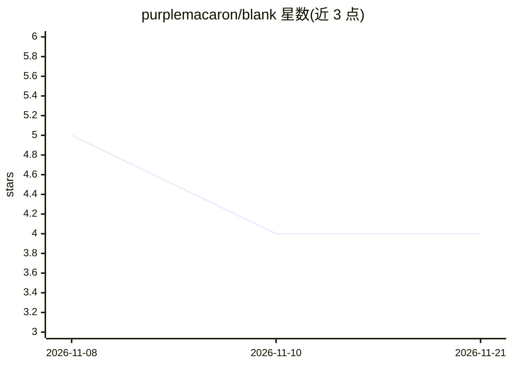

# purplemacaron/blank

⭐ 4 · JavaScript · MIT · 推送 2026-11-11 · [GitHub](https://github.com/purplemacaron/blank) · [官网](https://purplemacaron.github.io/blank/) · 个人维护

**本地优先的桌面 AI agent 框架：聊天、代码、工具与媒体**

基于 Electron 的桌面 agent harness，提供流式响应、带逐工具审批的调用、计划栏、检查点、上下文压缩、子代理与持久记忆。内置接入多家模型服务商及任意 OpenAI/Anthropic/Gemini 兼容端点，支持 MCP 服务器、computer use、多代理团队、git worktree 隔离、定时自动化与本地审计日志。提供桌面应用与共享会话的终端 TUI 客户端，界面支持韩语与英语，数据以纯文件存于 ~/.blank。本地服务商需自行启动其运行时。

## 筛选速览

| 维度 | 判定 | 备注 |
|---|---|---|
| AI 角色 | `ai-ecosystem` | LLM/agent 周边工具 |
| 许可风险 | `permissive` | MIT |
| 部署形态 | `library` | 以包/库形式分发 |
| 模型依赖 | local-ok | 支持本地模型 |
| 硬件要求 | — | 无带数字的原话,不猜 |
| 安装摩擦 | `medium` | 含编译或系统依赖之一 |
| 成熟度 | — | 结构信号不足 |

## 能力要点

- 内置 Anthropic/OpenAI/Google 等 12 家服务商及自定义兼容端点，多 key 自动轮换
- stdio/HTTP MCP 服务器、内置 SSH MCP、插件一键安装
- computer use：截图加鼠标键盘输入，全部经审批策略
- 聊天内媒体生成（ComfyUI/OpenAI Images/Stability 等引擎）与本地 Paper 页面库

## 适用场景

- 在桌面端用带审批的 agent 执行代码编辑与 shell 任务
- 通过 SSH MCP 让 agent 在远程主机上跑审批门控命令
- 用定时/文件变更/webhook 触发自动化 prompt 任务
- 本地运行 Ollama/LM Studio 模型进行离线对话

## 场景标签

`Agent 框架` `GUI 自动化` `图像生成` `编码 Agent` · 领域:Agent 开发

## 证据(README 行号)

> L2:  blank — a quiet, local-first agent harness for your desktop
> L36: - Built in: Anthropic, OpenAI, Google, OpenRouter, xAI, DeepSeek, Mistral, Groq, Together, Cerebras, Ollama and LM 
> L33: Streaming responses, tool calls with per-tool approvals, a live plan rail, checkpoints, automatic context compactio

## 星数曲线

2026-11-08 5 → 2026-11-21 4（-1）

---
*卡片 v1 · prompt 1.4 · 生成 2026-11-21 · 置信度 high · 依据 README sha `edd4ef143d88` · [字段定义](../../DATASET.md)*
