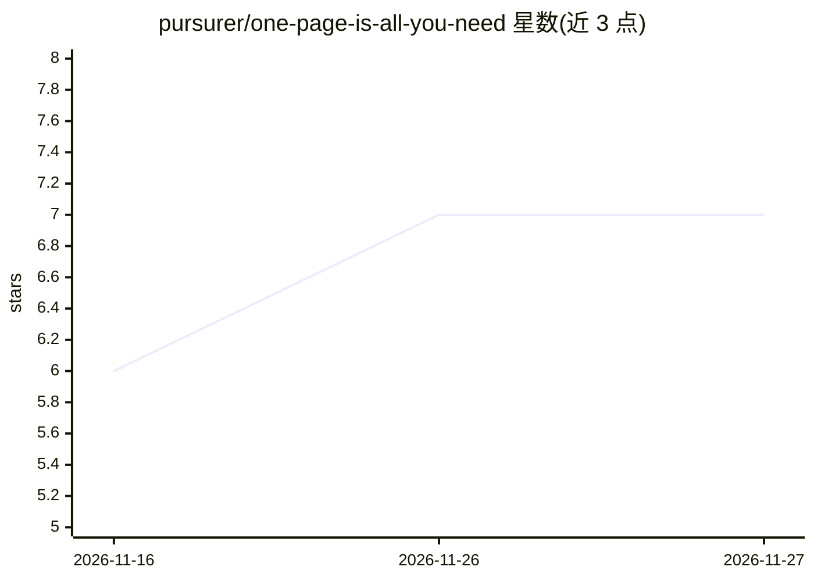

# pursurer/one-page-is-all-you-need

⭐ 7 · HTML · MIT · 推送 2026-11-15 · [GitHub](https://github.com/pursurer/one-page-is-all-you-need) · [官网](https://pursurer.github.io/one-page-is-all-you-need/) · 个人维护

**n8n 每日一页简报：Agent 汇总七个信息源并配 ASCII 锦鲤页面**

EPITA 课程项目，由两个 n8n 工作流组成：08:00 构建工作流抓取 Gmail、课表、AI 新闻、股票、比价、机票等七个来源，缓存失败回退，由编辑 Agent（n8n AI Agent 节点中的 Claude Haiku）挑选当日五条要事并标注来源，经 schema 校验后存入 Data Table；服务工作流读取 EDITION 注入单文件 HTML 模板返回页面，页面以全屏 ASCII 锦鲤池塘开场，黑猫动画标记数字与关键词。页面无构建步骤，附 Chrome 新标签页扩展，凭据缺失的来源自动显示为未连接。

## 筛选速览

| 维度 | 判定 | 备注 |
|---|---|---|
| AI 角色 | `ai-native` | 本体是模型或模型工具 |
| 许可风险 | `permissive` | MIT |
| 部署形态 | `self-host` | docker 或自建部署 |
| 模型依赖 | locked-api |  |
| 硬件要求 | — | 无带数字的原话,不猜 |
| 安装摩擦 | `low` | 无编译、无系统依赖或容器化 |
| 成熟度 | — | 结构信号不足 |

## 能力要点

- n8n 双工作流架构：构建 EDITION 与 webhook 服务页面
- 编辑 Agent 挑选五条要事，每条注明来源与工具，schema 校验，失败则保留昨日页面
- 失败来源回退缓存并标记 stale，中法文翻译逐行校验
- 单文件 HTML 页面配 ASCII 锦鲤池塘与黑猫动画，附 Chrome 新标签扩展

## 适用场景

- 每天早上生成一份包含邮件、课表、AI 新闻与市场行情的一页简报
- 监控关注商品的最低价并对比七天低价
- 用个人课表 ICS 自动检查未来 14 天课程冲突

## 场景标签

`工作流自动化` · 领域:效率与自动化

## 证据(README 行号)

> L21: |**Today's five**|All of the below|The editor agent (Claude Haiku 5.5 in an n8n AI Agent node) picks the five items
> L42: 1. **Daily Page · 1 Build edition** runs at 08:00, or when the page's Rebuild button posts to `/webhook/rebuild`. I

## 星数曲线

2026-11-16 6 → 2026-11-27 7（+1）

---
*卡片 v1 · prompt 1.4 · 生成 2026-11-20 · 置信度 high · 依据 README sha `8fe070062695` · [字段定义](../../DATASET.md)*
