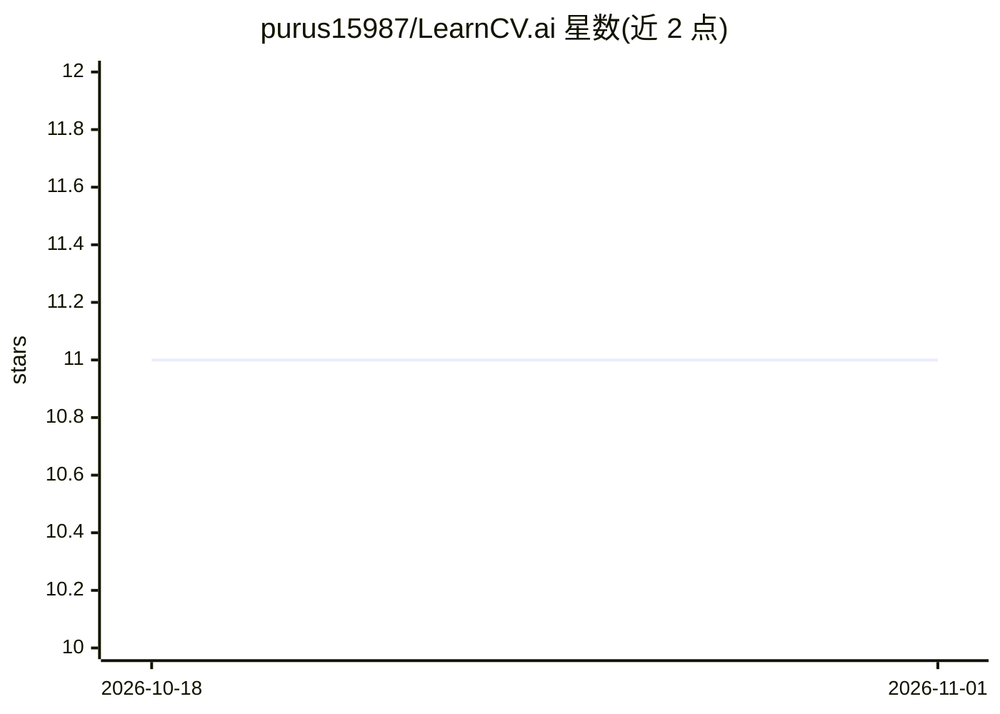

# purus15987/LearnCV.ai

⭐ 11 · Jupyter Notebook · MIT · 推送 2026-10-12 · [GitHub](https://github.com/purus15987/LearnCV.ai) · [官网](https://purus15987.github.io/LearnCV.ai/) · 个人维护

**面向本科生的计算机视觉课程主页：理论、实验与项目**

JBIET 学院 M. Purushotham 讲授的 Computer Vision（2025）官方课程主页仓库。内容按 Module 0–6 组织，覆盖编程前置（Python/NumPy/数据科学/Web 基础）、图像处理、特征工程、3D 视觉与运动、实时模式识别、深度学习及生成式视觉。以表格索引形式逐日追踪讲义、10 个实践实验（含 OpenCV、CNN/Transformer 训练、SIFT/HOG 经典特征、Flask/ONNX/TFLite 部署）、7 项作业与项目选题，并链接 Google Sheet 教学计划。属课程资料聚合，站点仍在持续建设中。

## 筛选速览

| 维度 | 判定 | 备注 |
|---|---|---|
| AI 角色 | `ai-knowledge` | 知识聚合/清单类 |
| 许可风险 | `permissive` | MIT |
| 部署形态 | `None` |  |
| 模型依赖 | — | README 未给出锁定关系 |
| 硬件要求 | — | 无带数字的原话,不猜 |
| 安装摩擦 | `low` | 无编译、无系统依赖或容器化 |
| 成熟度 | `idea` | |

## 能力要点

- Module 0–6 课程结构，从编程前置到深度学习与 GenAI for Vision
- 逐日讲义索引（Hough 变换、立体视觉、光流、ADAS 应用等）
- 10 个实践实验含数据集工程、DL 模型训练与部署（Flask/ONNX/TFLite）
- 7 项作业覆盖从数学基础到研究论文写作的完整流程

## 适用场景

- 按课表跟进计算机视觉课程讲义与实验
- 寻找从数学基础到模型部署的 CV 学习路径
- 作为课程项目选题与作业提交的追踪入口

## 场景标签

`教程课程` · 领域:学习与行业

## 证据(README 行号)

> L3: # Computer Vision Course (2025)
> L5: Welcome to the official course homepage for **Computer Vision**, taught by M. Purushotham, ML Researcher (GenAI/CV f
> L9: - **Module 0**: Programming Prerequisites

## 星数曲线

2026-10-18 11 → 2026-11-01 11（+0）

---
*卡片 v1 · prompt 1.4 · 生成 2026-11-01 · 置信度 high · 依据 README sha `8407964bdf92` · [字段定义](../../DATASET.md)*
