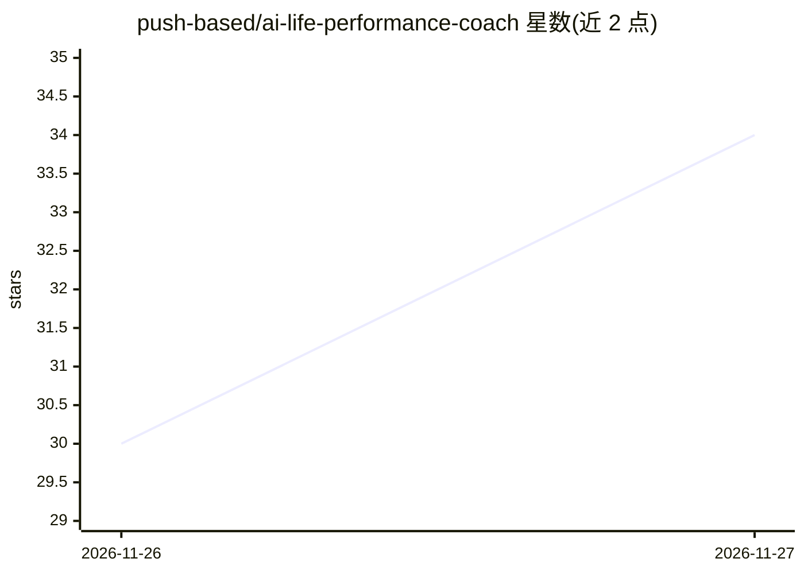

# push-based/ai-life-performance-coach

⭐ 34 · TypeScript · MIT · 推送 2026-11-26 · [GitHub](https://github.com/push-based/ai-life-performance-coach) · [官网](https://push-based.github.io/ai-life-performance-coach/) · 组织维护

**在 Obsidian 仓库中组织笔记、AI 陪练学习并规划日程的系统**

运行在用户自有 Obsidian 仓库上的 CLI 与本地服务组合，功能分四块：按 PARA 方法组织笔记与任务链接；七步学习流程（读、分组、生成、检索、精炼、间隔、教学），由本地 Gemma 模型做离线陪练、Gemini 做在线判卷（可选，无 key 时仅 coach judge 不可用）；浏览器端展示笔记图谱与学习进度；配合 Claude Code/Codex 等 AI 编码代理执行周/年规划。依赖 Node.js 24+、Obsidian 与 Ollama，通过 npm 从源码构建运行。README 声明其为个人项目且仍在变动。

## 筛选速览

| 维度 | 判定 | 备注 |
|---|---|---|
| AI 角色 | `ai-native` | 本体是模型或模型工具 |
| 许可风险 | `permissive` | MIT |
| 部署形态 | `library` | 以包/库形式分发 |
| 模型依赖 | local-ok | 支持本地模型 |
| 硬件要求 | — | 无带数字的原话,不猜 |
| 安装摩擦 | `low` | 无编译、无系统依赖或容器化 |
| 成熟度 | `idea` | |

## 能力要点

- 本地 Gemma（Ollama）离线陪练，仅问答文本发送给在线 Gemini 判卷
- PDF 按章节转笔记，标注后经 coach synthesize 生成概念笔记
- 目标-周-月-年逐级链接的规划与习惯打卡、多周期回顾
- 单一 vault server 读写网关，变更先预览后写入

## 适用场景

- 把读书/课程/论文笔记整理成 PARA 结构并互链
- 用 AI 陪练把读过的内容练到能教给别人
- 在浏览器中查看笔记图谱与每个想法的学习进度
- 让 AI 编码代理按目标体系滚动规划每周任务与习惯

## 场景标签

`知识库管理` · 领域:知识与检索

## 证据(README 行号)

> L9: ai-coach works on your own notes in an Obsidian vault. It does four things:
> L59: A local model (Gemma on Ollama) does the sparring, offline. It pushes back on vague answers and buzzwords, and name
> L68: An online judge (Gemini) then checks your answers for gaps. It sees only the questions and your answers, never your

## 星数曲线

2026-11-26 30 → 2026-11-27 34（+4）

---
*卡片 v1 · prompt 1.4 · 生成 2026-11-26 · 置信度 high · 依据 README sha `ef036c9167d7` · [字段定义](../../DATASET.md)*
