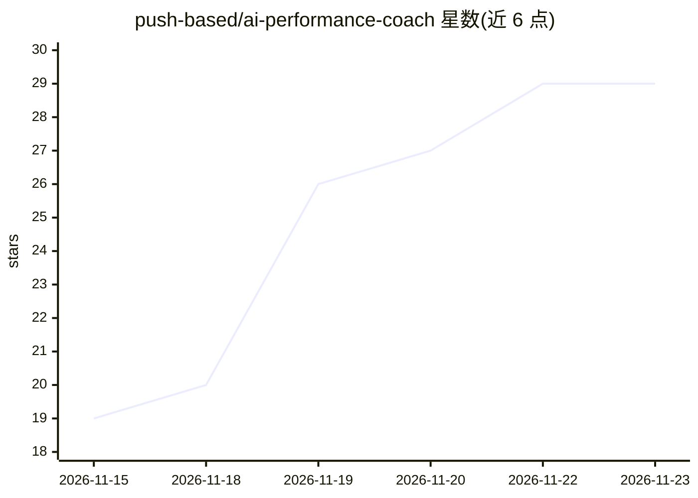

# push-based/ai-performance-coach

⭐ 29 · TypeScript · MIT · 推送 2026-11-22 · [GitHub](https://github.com/push-based/ai-performance-coach) · [官网](https://push-based.github.io/ai-performance-coach/) · 个人维护

**Obsidian 知识库的 AI 学习与规划系统：PARA 整理＋七步学习＋计划**

运行在用户自有 Obsidian vault 上的笔记组织与学习工具：按 PARA（Projects/Areas/Resources/Archive）组织 Markdown 笔记并通过链接互联；提供从阅读到可讲授的七步学习流程，本地 Gemma 模型（经 Ollama 离线运行）做对练质询，Gemini 在线裁判仅接收问题与回答；支持 PDF 按章节转笔记、间隔复习与浏览器端图谱/阅读/计划视图。规划功能需配合 Claude Code 或 Codex 等 AI 编码 agent 使用。安装需 Node.js 24+、Obsidian、Ollama，Gemini key 与 AI agent 为可选。

## 筛选速览

| 维度 | 判定 | 备注 |
|---|---|---|
| AI 角色 | `ai-native` | 本体是模型或模型工具 |
| 许可风险 | `permissive` | MIT |
| 部署形态 | `library` | 以包/库形式分发 |
| 模型依赖 | local-ok | 支持本地模型 |
| 硬件要求 | — | 无带数字的原话,不猜 |
| 安装摩擦 | `low` | 无编译、无系统依赖或容器化 |
| 成熟度 | `idea` | |

## 能力要点

- PARA 四类文件夹组织笔记并以上下层链接互联
- 七步学习流程：read→group→generate→retrieve→elaborate→space→teach，配 coach 系列 CLI
- 本地 Gemma/Ollama 离线对练，Gemini 在线裁判只看问题与回答不看笔记
- 单一把守：仅 vault server 读写库，所有变更先预览确认

## 适用场景

- 把读过的书/课程/论文逐步学到能讲授的程度
- 用 PARA 方法整理和归档 Obsidian 笔记
- 在 AI 编码 agent 里做周/月/年计划与习惯追踪
- 在浏览器里查看笔记图谱与各概念掌握进度

## 场景标签

`知识库管理` · 领域:知识与检索

## 证据(README 行号)

> L12: - **Learn.** It takes an idea from a book, a course, a paper or a talk from "I've read it" to "I can teach it", in 
> L59: A local model (Gemma on Ollama) does the sparring, offline. It pushes back on vague answers and buzzwords, and name
> L68: An online judge (Gemini) then checks your answers for gaps. It sees only the questions and your answers, never your

## 星数曲线

2026-11-15 19 → 2026-11-23 29（+10）

---
*卡片 v1 · prompt 1.4 · 生成 2026-11-18 · 置信度 high · 依据 README sha `8b7f1f5d5a9c` · [字段定义](../../DATASET.md)*
