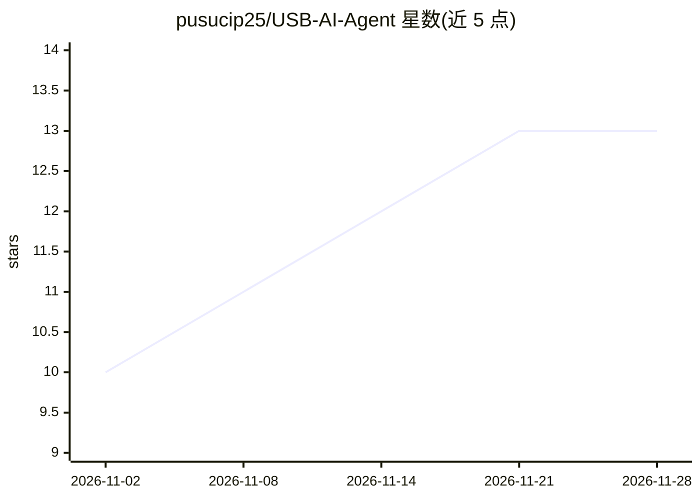

# pusucip25/USB-AI-Agent

⭐ 13 · Python · 推送 2026-11-21 · [GitHub](https://github.com/pusucip25/USB-AI-Agent) · 个人维护

**从 USB/SSD 启动的免安装离线自主 AI agent**

基于可移植 Ollama 引擎与 5 个预配置 GGUF 模型构建的便携式 AI agent，首次运行通过脚本安装可移植 Python、引擎与模型（约 25GB），之后完全离线运行。提供 13 个自主调用的工具：DuckDuckGo 搜索、多源深度检索、Holehe/Maigret 等 OSINT 查询、文件读写、Python 与 Shell 执行、持久化记忆，由模型自主决定工具调用。附带本地 Web 聊天界面，并含 3 个可侧载的 Android 应用。数据仅保存在 USB 驱动器上，支持 Windows 与 Linux（含 Tails）。

## 筛选速览

| 维度 | 判定 | 备注 |
|---|---|---|
| AI 角色 | `ai-native` | 本体是模型或模型工具 |
| 许可风险 | `none` | — |
| 部署形态 | `desktop` | 安装包/桌面程序 |
| 模型依赖 | local-ok | 支持本地模型 |
| 硬件要求 | — | 无带数字的原话,不猜 |
| 安装摩擦 | `low` | 无编译、无系统依赖或容器化 |
| 成熟度 | — | 结构信号不足 |

## 能力要点

- 13 个自主调用工具：搜索、深度检索、OSINT、文件操作、代码执行、记忆
- 预配置 5 个 GGUF 模型，一次下载跨平台复用
- 完全离线运行，聊天记录仅保存到 USB 驱动器
- 附带本地 Web 聊天 UI 与 3 个 Capacitor Android 应用

## 适用场景

- 在无网络环境下运行本地 AI agent
- 离线做邮箱/用户名等 OSINT 查询
- 在他人电脑上不留痕迹地使用 AI 助手
- 在 Tails 等注重隐私的发行版上运行 agent

## 场景标签

`AI 助手` · 领域:对话与助手

## 证据(README 行号)

> L3: > Plug in. Run one script. Get a fully autonomous AI agent with 13 tools, deep search, OSINT, and persistent memory 
> L53: The agent has **13 tools** it can use autonomously:
> L73: Pre-configured for 5 uncensored GGUF models (~25GB total):

## 星数曲线

2026-11-02 10 → 2026-11-28 13（+3）

---
*卡片 v1 · prompt 1.4 · 生成 2026-11-18 · 置信度 high · 依据 README sha `2336cafb1394` · [字段定义](../../DATASET.md)*
