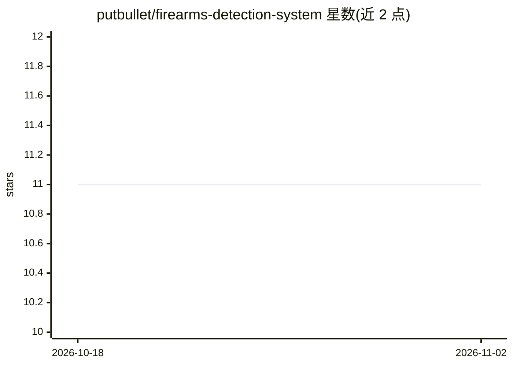

# putbullet/firearms-detection-system

⭐ 11 · Python · MIT · 推送 2025-12-22 · [GitHub](https://github.com/putbullet/firearms-detection-system) · 个人维护

**结合枪支检测与姿态估计的实时持枪者检测系统**

基于 YOLOv11 的双通道检测系统：一路用自定义训练的 YOLOv11 模型识别枪支/步枪/火焰，另一路用 YOLOv11-pose 提取 17 点人体关键点，并与 52 个参考射击姿态数据库比对（相似度阈值默认 0.70），两者同时命中时输出 ACTIVE SHOOTER 告警。支持图像、视频文件与摄像头实时三种输入，视频编码带 FFmpeg→OpenCV→逐帧三级回退。作者声明系统仍在开发与训练中，定位为安防监控与学术研究用途，README 列出误报、光照依赖与仅覆盖已训练姿态等限制。

## 筛选速览

| 维度 | 判定 | 备注 |
|---|---|---|
| AI 角色 | `ai-native` | 本体是模型或模型工具 |
| 许可风险 | `permissive` | MIT |
| 部署形态 | `None` |  |
| 模型依赖 | — | README 未给出锁定关系 |
| 硬件要求 | — | 无带数字的原话,不猜 |
| 安装摩擦 | `medium` | 含编译或系统依赖之一 |
| 成熟度 | — | 结构信号不足 |

## 能力要点

- 枪支检测（YOLOv11 自定义训练）与姿态估计（17 点关键点）双通道联合判定
- 52 个参考射击姿态数据库匹配，阈值可调（0.60-0.80）
- 支持图像/视频/摄像头三种输入，视频输出三级编码回退
- CPU 约 4 FPS、GPU 约 15+ FPS 的实测处理速度

## 适用场景

- 对 CCTV 画面做枪支与射击姿态的实时分析
- 威胁检测方向的学术研究与实验
- 安防系统评估与安防人员训练模拟

## 场景标签

`目标检测` `网络安全` · 领域:学习与行业

## 证据(README 行号)

> L3: An advanced AI-powered system that combines **gun detection** and **pose estimation** to identify potential active s
> L85: - **Gun Detection**: Custom YOLOv11 model trained on gun/rifle/fire classes
> L86: - **Pose Estimation**: YOLOv11-pose for 17-point COCO keypoint detection

## 星数曲线

2026-10-18 11 → 2026-11-02 11（+0）

---
*卡片 v1 · prompt 1.4 · 生成 2026-11-01 · 置信度 high · 依据 README sha `ccb6a9ea5b87` · [字段定义](../../DATASET.md)*
