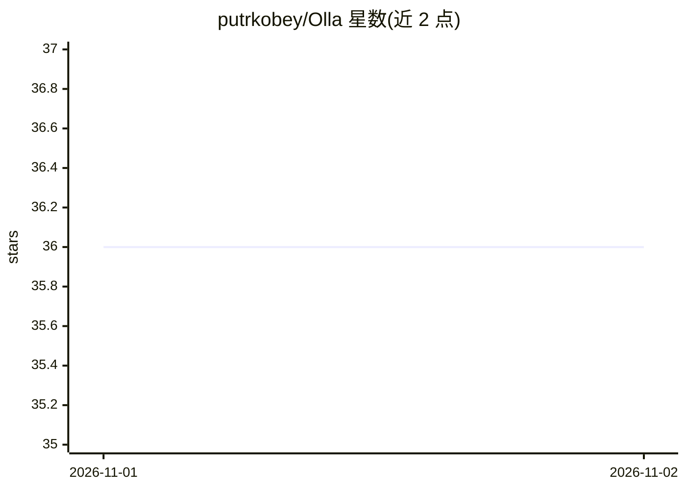

# putrkobey/Olla

⭐ 36 · Go · Apache-2.0 · 推送 2026-11-01 · [GitHub](https://github.com/putrkobey/Olla) · 组织维护

**自托管 LLM 推理节点的负载均衡与代理服务器**

用 Go 编写的单二进制 LLM 代理与负载均衡器，面向已有自托管推理基础设施的运维与开发者。它将请求路由到 Ollama、vLLM、llama.cpp、SGLang、LM Studio 等多种后端，提供基于优先级的路由与故障转移、KV-cache 感知的会话亲和、端点健康检查与熔断、模型自动发现，并暴露 OpenAI 与 Anthropic 两种 API 格式（透传或格式转换）。内嵌只读管理面板，运行内存低于 50MB。由 TensorFoundry 维护，Apache 2.0 许可。

## 筛选速览

| 维度 | 判定 | 备注 |
|---|---|---|
| AI 角色 | `ai-ecosystem` | LLM/agent 周边工具 |
| 许可风险 | `permissive` | Apache-2.0 |
| 部署形态 | `self-host` | docker 或自建部署 |
| 模型依赖 | local-ok | 支持本地模型 |
| 硬件要求 | — | 无带数字的原话,不猜 |
| 安装摩擦 | `low` | 无编译、无系统依赖或容器化 |
| 成熟度 | — | 结构信号不足 |

## 能力要点

- 原生支持 Ollama/vLLM/llama.cpp/SGLang/LM Studio 等 10 余种自托管后端
- 优先级路由、自动故障转移、健康检查与熔断器
- OpenAI 与 Anthropic Messages API 双格式（透传或自动转换），可供 Claude Code 等 CLI 使用
- 单二进制 + 内嵌只读管理面板，内存占用低于 50MB

## 适用场景

- 多台机器上的 Ollama/vLLM 实例统一接入与负载均衡
- 为 Claude Code 等 CLI 工具接本地模型并做后端故障转移
- 家庭实验室或企业 GPU 集群的 LLM 流量路由

## 场景标签

`模型网关` · 领域:Agent 开发

## 证据(README 行号)

> L26: Olla is a high-performance, low-overhead, low-latency proxy and load balancer for managing LLM infrastructure. It i
> L28: Olla works alongside API gateways like LiteLLM or orchestration platforms like GPUStack, focusing on making your **

## 星数曲线

2026-11-01 36 → 2026-11-02 36（+0）

---
*卡片 v1 · prompt 1.4 · 生成 2026-10-31 · 置信度 high · 依据 README sha `749a3be2c00d` · [字段定义](../../DATASET.md)*
