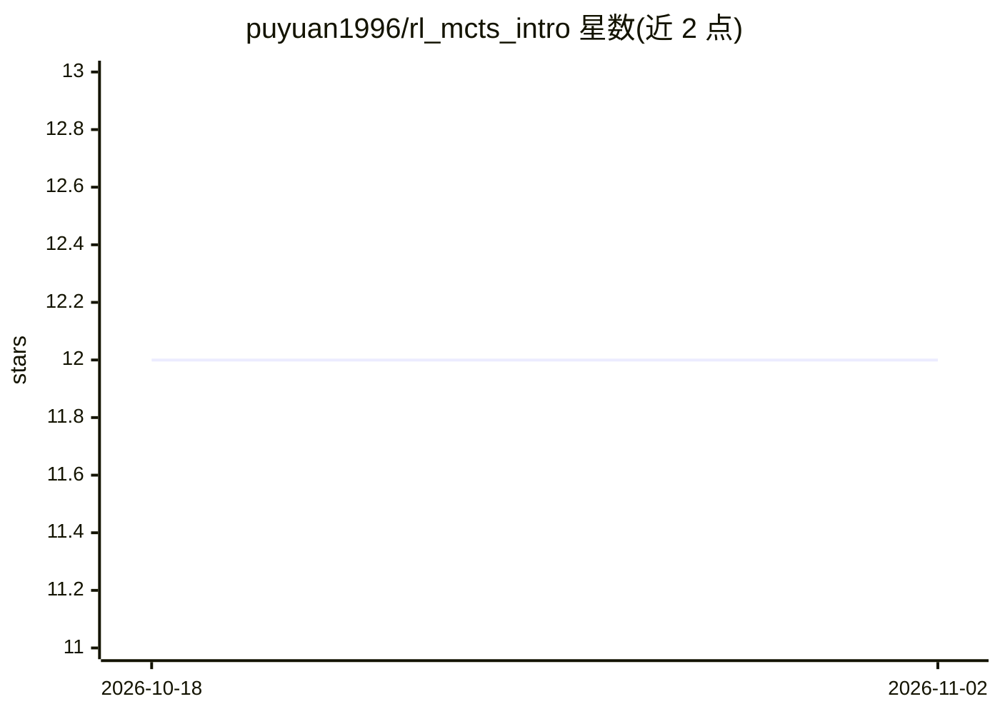

# puyuan1996/rl_mcts_intro

⭐ 12 · 推送 2025-12-14 · [GitHub](https://github.com/puyuan1996/rl_mcts_intro) · 组织维护 · 中文 README

**强化学习与 MCTS 入门讲座 PPT 与学习资源清单**

由上海人工智能实验室 OpenDILab 成员主讲的《强化学习与蒙特卡洛树搜索简介》内容仓库：提供 171 页中文讲座 PPT，覆盖 RL 基础（MDP、值函数、Q-Learning、DQN、策略梯度、PPO 等）、MCTS 核心算法（UCB/UCT/PUCT、AlphaZero/MuZero 系）、OpenDILab 团队研究成果（LightZero/UniZero/ReZero/ScaleZero）及 MCTS 与 LLM 结合的前沿进展；另收录书籍、视频课程、代码库与论文资源链接。PPT 声明仅供学习交流，可能存在错误。

## 筛选速览

| 维度 | 判定 | 备注 |
|---|---|---|
| AI 角色 | `ai-knowledge` | 知识聚合/清单类 |
| 许可风险 | `none` | — |
| 部署形态 | `None` |  |
| 模型依赖 | — | README 未给出锁定关系 |
| 硬件要求 | — | 无带数字的原话,不猜 |
| 安装摩擦 | `low` | 无编译、无系统依赖或容器化 |
| 成熟度 | — | 结构信号不足 |

## 能力要点

- 171 页中文讲座 PPT，覆盖 RL 基础到 MCTS 前沿算法
- 包含 OpenDILab 团队 LightZero/UniZero/ReZero/ScaleZero 等研究介绍
- 附书籍、视频课程、代码框架与论文资源链接

## 适用场景

- 系统学习强化学习与蒙特卡洛树搜索的理论与算法
- 了解 MCTS+RL 框架及与 LLM 结合的前沿进展
- 查找 RL 方向的书籍、课程与代码资源

## 场景标签

`精选清单` `教程课程` · 领域:学习与行业

## 证据(README 行号)

> L3: 欢迎访问本仓库！本仓库旨在分享《强化学习 (RL) 与蒙特卡洛树搜索 (MCTS) 简介》的讲座内容，包括精心准备的 PPT 和相关学习资源，助力大家快速掌握相关知识并开展交流与讨论。
> L9: - **讲座 PPT** (`intro_rl_mcts_2025_zh.pptx`): 171 页精心制作的讲座幻灯片，系统全面地介绍：
> L15: - **推荐资源链接**: 包括精选书籍、论文、视频教程与代码库，帮助您扩展学习。

## 星数曲线

2026-10-18 12 → 2026-11-02 12（+0）

---
*卡片 v1 · prompt 1.4 · 生成 2026-11-01 · 置信度 high · 依据 README sha `be4c7758f490` · [字段定义](../../DATASET.md)*
