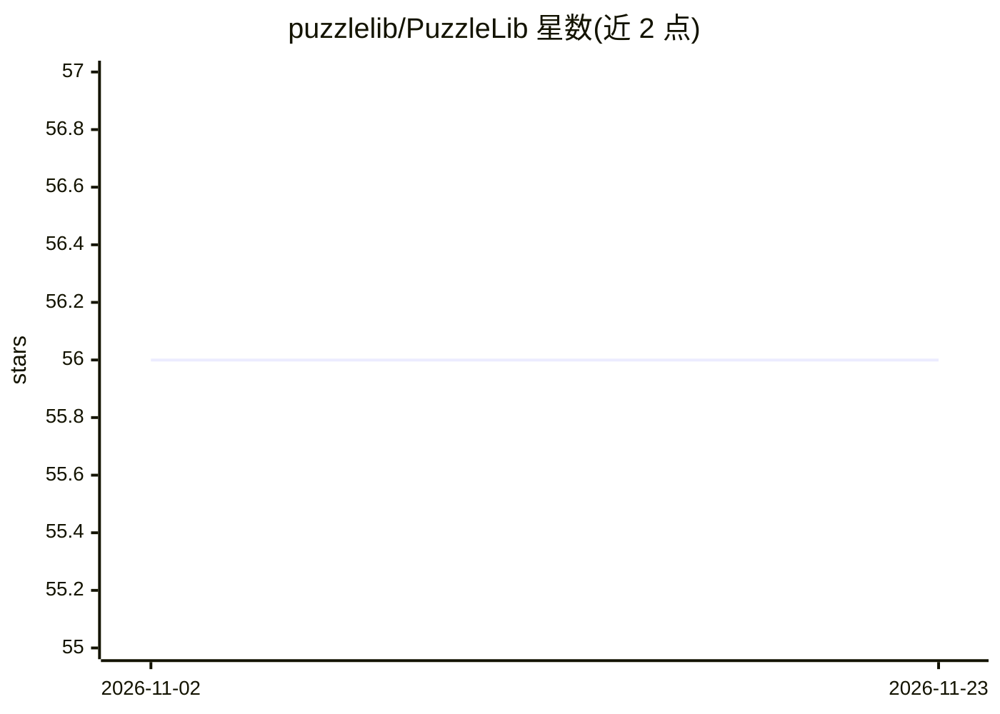

# puzzlelib/PuzzleLib

⭐ 56 · Python · Apache-2.0 · 推送 2026-11-02 · [GitHub](https://github.com/puzzlelib/PuzzleLib) · 组织维护

**Python 深度学习框架，支持 NVIDIA/AMD GPU 与多种 CPU 后端**

高层级深度学习框架，用 Python 编写，用于构建神经网络，强调模块化与动态结构。计算后端覆盖 NVIDIA GPU（CUDA）、AMD GPU（ROCm）、Intel CPU（mkl-dnn）与 AMD CPU（numpy）。安装依赖详细步骤指向外部文档（Windows、Linux/macOS 各有说明），README 本身未给出具体安装命令。以 Apache 2.0 许可发布，文档含英文与俄文双语版本。

## 筛选速览

| 维度 | 判定 | 备注 |
|---|---|---|
| AI 角色 | `ai-ecosystem` | LLM/agent 周边工具 |
| 许可风险 | `permissive` | Apache-2.0 |
| 部署形态 | `None` |  |
| 模型依赖 | — | README 未给出锁定关系 |
| 硬件要求 | — | 无带数字的原话,不猜 |
| 安装摩擦 | `medium` | 含编译或系统依赖之一 |
| 成熟度 | — | 结构信号不足 |

## 能力要点

- 四类计算后端：CUDA、ROCm、mkl-dnn、numpy
- Python 编写，模块化且动态
- README 提供英文与俄文双语说明

## 适用场景

- 在 NVIDIA 或 AMD GPU 上训练神经网络模型
- 跨不同硬件后端运行同一套模型代码
- 需要模块化结构自定义网络组件的研究开发

## 场景标签

`模型训练` · 领域:训练与推理

## 证据(README 行号)

> L3: PuzzleLib is a high level Deep Learning framework with CPU (Intel/AMD) and GPU (NVIDIA/AMD) support. The library is 
> L9: PuzzleLib supports:

## 星数曲线

2026-11-02 56 → 2026-11-23 56（+0）

---
*卡片 v1 · prompt 1.4 · 生成 2026-11-18 · 置信度 high · 依据 README sha `d24098d6aca7` · [字段定义](../../DATASET.md)*
