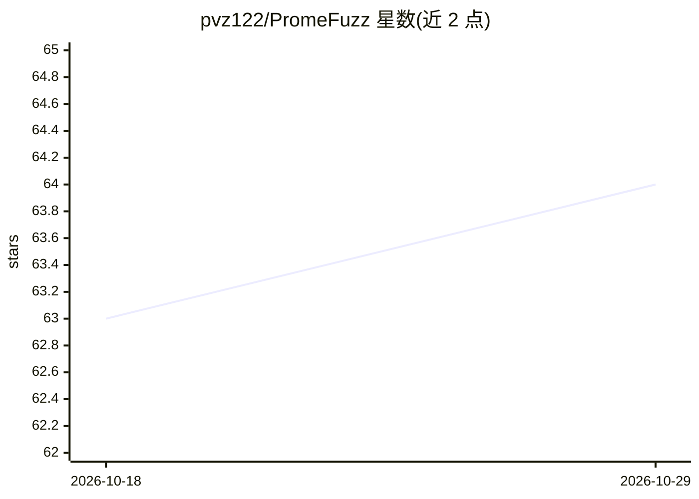

# pvz122/PromeFuzz

⭐ 64 · C++ · MIT · 推送 2026-07-30 · [GitHub](https://github.com/pvz122/PromeFuzz) · 组织维护

**为 C/C++ 库自动生成模糊测试 harness 的知识驱动框架**

PromeFuzz 是利用大语言模型为 C/C++ 库自动生成模糊测试 harness（fuzz driver）的框架。工作流为：preprocess 提取代码元数据与调用图知识，comprehend 用 LLM 理解库文档与源码语义，generate 基于知识生成 harness，analyze 分析 ASan 崩溃并出报告。需要配置生成模型与嵌入模型（如 DeepSeek、Ollama 嵌入），通过 config.toml 与 libraries.toml 两层配置驱动，支持 Docker 或手动（uv + 编译工具链）安装，论文被 ACM CCS 2025 接收。

## 筛选速览

| 维度 | 判定 | 备注 |
|---|---|---|
| AI 角色 | `ai-native` | 本体是模型或模型工具 |
| 许可风险 | `permissive` | MIT |
| 部署形态 | `self-host` | docker 或自建部署 |
| 模型依赖 | local-ok | 支持本地模型 |
| 硬件要求 | — | 无带数字的原话,不猜 |
| 安装摩擦 | `low` | 无编译、无系统依赖或容器化 |
| 成熟度 | — | 结构信号不足 |

## 能力要点

- 整合代码元数据、文档与 API 使用模式的四阶段端到端流水线
- 内置崩溃检测与分析（ASan 崩溃自动生成报告）
- 可配置 LLM 后端（生成/嵌入模型分离，支持 DeepSeek、Ollama 嵌入等）
- 为数据集内库提供自动化脚本，也支持自定义库接入

## 适用场景

- 为自己的 C/C++ 库自动生成模糊测试 harness 并发现漏洞
- 复现论文实验或对数据集内的库进行模糊测试
- 批量分析 fuzzing 触发的崩溃并生成报告

## 场景标签

`网络安全` · 领域:学习与行业

## 证据(README 行号)

> L12: **PromeFuzz** is a state-of-the-art framework for automatically generating fuzzing harnesses (fuzz drivers) for C a
> L109: - `comprehend`: Comprehend the library using LLM to extract documentation knowledge.
> L141: - **Generative Model** (e.g., `gpt-5`, `qwen-3`) Used for harness generation, library comprehension, and crash ana

## 星数曲线

2026-10-18 63 → 2026-10-29 64（+1）

---
*卡片 v1 · prompt 1.4 · 生成 2026-10-24 · 置信度 high · 依据 README sha `0f88ec71ad08` · [字段定义](../../DATASET.md)*
