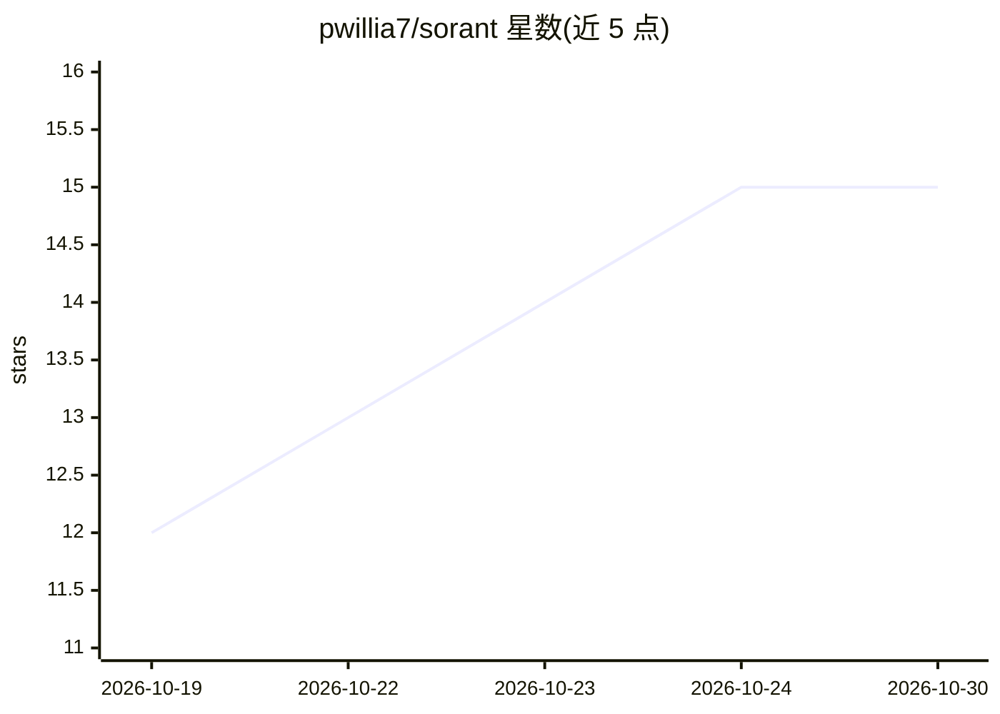

# pwillia7/sorant

⭐ 15 · TypeScript · MIT · 推送 2026-10-29 · [GitHub](https://github.com/pwillia7/sorant) · [官网](https://github.com/pwillia7/sorant/blob/main/docs/setup.md) · 个人维护

**基于自有 ComfyUI 的文生视频/音乐 Web 前端**

部署在 Vercel（或本地运行）的 Next.js Web 应用，连接用户自己的 ComfyUI 机器生成视频与音乐：提供 6 种 MiniMax H3 视频工作流（文生视频、图生视频、参考生成、Remix、Extend、音乐视频）、文生图、MiniMax Music 3 音乐生成、RTX 超分/SeedVR2 放大与 FLUX Kontext 图片编辑。模型权重与渲染留在本地 GPU，前端不含模型与数据库。提示词可由语言模型改写，支持编码 agent（Claude Code/Cursor 等）按 runbook 自动安装。硬件要求 12–24 GB NVIDIA GPU、64 GB 内存，全量磁盘约 337 GB。

## 筛选速览

| 维度 | 判定 | 备注 |
|---|---|---|
| AI 角色 | `ai-native` | 本体是模型或模型工具 |
| 许可风险 | `permissive` | MIT |
| 部署形态 | `library` | 以包/库形式分发 |
| 模型依赖 | — | README 未给出锁定关系 |
| 硬件要求 | — | 无带数字的原话,不猜 |
| 安装摩擦 | `low` | 无编译、无系统依赖或容器化 |
| 成熟度 | — | 结构信号不足 |

## 能力要点

- 6 种 MiniMax H3 视频工作流，含按节拍切分的音乐视频
- MiniMax Music 3 音乐生成与 FLUX Kontext 图片编辑
- 模型与渲染留在用户自己的 GPU，应用部署到 Vercel 或本地
- 支持编码 agent 按 docs/agent-setup.md 自动完成安装与部署

## 适用场景

- 在自己的 GPU 上用 Web 界面生成带配乐的视频片段
- 用一首歌自动切分场景并生成音乐视频
- 对已生成片段做 Remix、续接与超分放大

## 场景标签

`视频生成` `图像生成` · 领域:内容生成

## 证据(README 行号)

> L3: A web front end for making video and music on **your own ComfyUI**. Type a
> L15: Six video workflows on MiniMax H3, each producing a clip with a generated
> L31: Plus **Music** (MiniMax Music 3, a song from a description), **Upscale**

## 星数曲线

2026-10-19 12 → 2026-10-30 15（+3）

---
*卡片 v1 · prompt 1.4 · 生成 2026-10-30 · 置信度 high · 依据 README sha `cd3bcedabcd2` · [字段定义](../../DATASET.md)*
