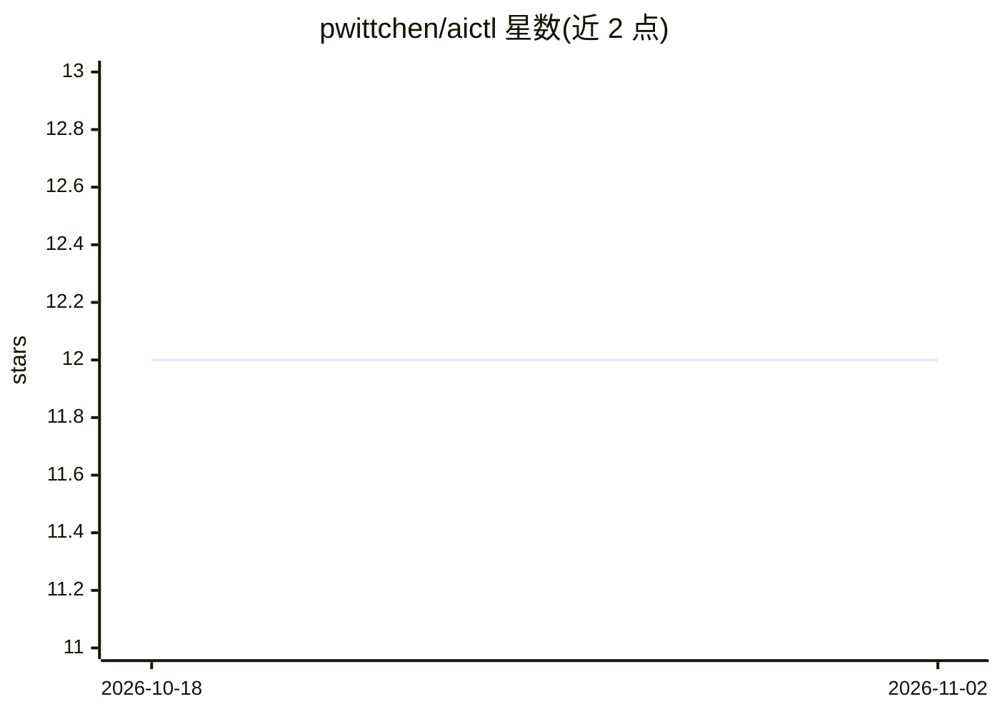

# pwittchen/aictl

⭐ 12 · Rust · NOASSERTION · 推送 2026-10-23 · [GitHub](https://github.com/pwittchen/aictl) · [官网](https://aictl.app) · 个人维护

**运行云端与本地模型的终端/macOS AI agent 运行时**

Rust 编写的 AI agent 工具集，含三部分：CLI（交互式 REPL，支持工具、agents、skills、MCP）、Tauri 构建的 macOS 桌面应用（与 CLI 共用 aictl-core 引擎，提供 Apple Silicon 与 Intel 的 .dmg），以及 aictl-server——暴露 OpenAI 兼容 HTTP 端点的纯代理，带脱敏、提示注入拦截、审计与主密钥门控，还可作为 Claude Code 的 Anthropic 兼容推理上游并做跨提供商路由。状态存于 ~/.aictl/。采用 PolyForm Noncommercial 许可，商业使用需另行联系获取商业许可。

## 筛选速览

| 维度 | 判定 | 备注 |
|---|---|---|
| AI 角色 | `ai-native` | 本体是模型或模型工具 |
| 许可风险 | `none` | NOASSERTION |
| 部署形态 | `desktop` | 安装包/桌面程序 |
| 模型依赖 | — | README 未给出锁定关系 |
| 硬件要求 | — | 无带数字的原话,不猜 |
| 安装摩擦 | `low` | 无编译、无系统依赖或容器化 |
| 成熟度 | `idea` | |

## 能力要点

- CLI、桌面应用、HTTP 服务器三形态共用同一引擎与配置
- aictl-server 提供 OpenAI/Anthropic 兼容端点，含脱敏、提示注入拦截与审计
- 支持 gguf、mlx 等可选本地模型功能
- 提供 Claude Code skills 用于项目维护工作流

## 适用场景

- 在终端或 macOS 桌面用统一配置调用云端与本地模型
- 部署带审计与主密钥管控的团队 LLM 代理服务器
- 作为 Claude Code 的推理上游做跨提供商路由

## 场景标签

`模型网关` `AI 助手` · 领域:Agent 开发

## 证据(README 行号)

> L7: Native AI agent for your terminal and macOS desktop.
> L18: You can use **aictl** on your desktop and in your terminal — with a single configuration and feature parity between
> L31: # Interactive REPL (after running aictl --config once to set provider + key):

## 星数曲线

2026-10-18 12 → 2026-11-02 12（+0）

---
*卡片 v1 · prompt 1.4 · 生成 2026-11-01 · 置信度 high · 依据 README sha `ceb324b2115b` · [字段定义](../../DATASET.md)*
