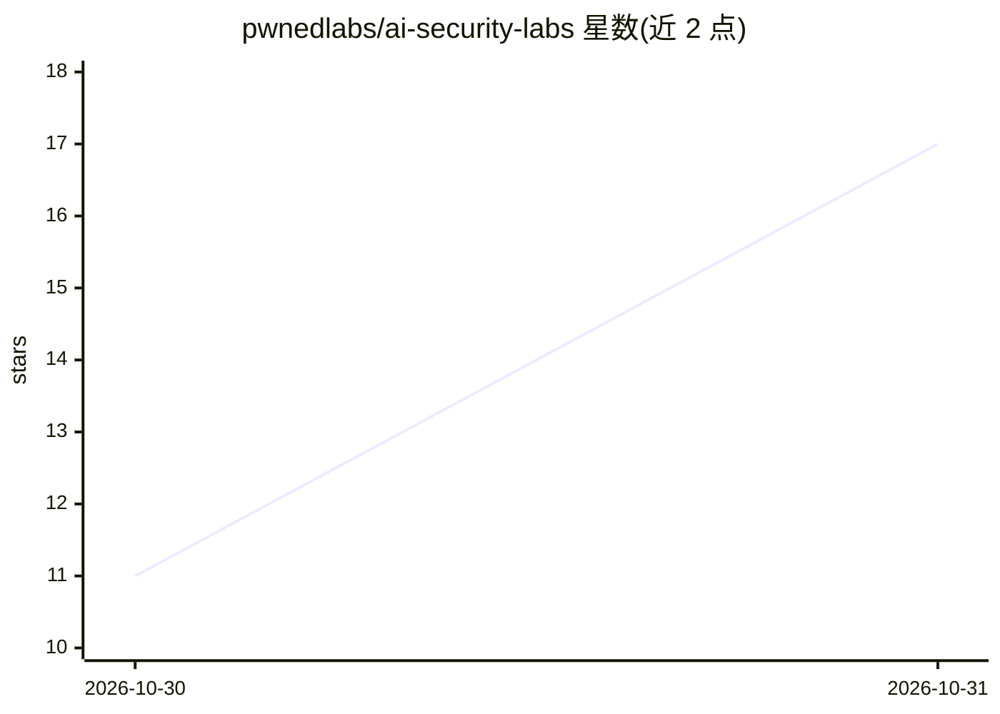

# pwnedlabs/ai-security-labs

⭐ 17 · CC-BY-4.0 · 推送 2026-10-30 · [GitHub](https://github.com/pwnedlabs/ai-security-labs) · [官网](https://pwnedlabs.io) · 组织维护

**AI 安全训练资源清单：LLM/RAG/Agent 攻防靶场与课程**

由 Pwned Labs 维护的 AI 安全训练资源清单：收录动手靶场与挑战（Lakera Gandalf、Microsoft AI Red Teaming Playground、Damn Vulnerable LLM Agent、Damn Vulnerable MCP Server、PortSwigger、Wiz 等）、红队工具（garak、PyRIT、promptfoo）、参考资料（OWASP LLM/Agentic Top 10、MITRE ATLAS、NIST AI 600-1）及课程认证。自维护内容与社区项目分别标注，并给出一条从直接注入到工具滥用再到 OWASP 映射的学习路径。清单以 CC BY 4.0 许可。

## 筛选速览

| 维度 | 判定 | 备注 |
|---|---|---|
| AI 角色 | `ai-knowledge` | 知识聚合/清单类 |
| 许可风险 | `viral` | CC-BY-4.0 |
| 部署形态 | `None` |  |
| 模型依赖 | — | README 未给出锁定关系 |
| 硬件要求 | — | 无带数字的原话,不猜 |
| 安装摩擦 | `low` | 无编译、无系统依赖或容器化 |
| 成熟度 | — | 结构信号不足 |

## 能力要点

- 覆盖靶场、工具、参考标准、课程四类资源并标注自维护/社区来源
- 收录 MCP 服务器攻击（tool poisoning、tool shadowing、token theft）靶场
- 提供六步学习路径：从 LLM 应用结构到端到端漏洞利用链考试

## 适用场景

- 寻找可动手练习提示注入、RAG 投毒、Agent 滥用的靶场
- 为 AI 红队选型 garak/PyRIT/promptfoo 等自动化工具
- 按 OWASP LLM Top 10 与 MITRE ATLAS 映射发现结果

## 场景标签

`网络安全` `精选清单` · 领域:学习与行业

## 证据(README 行号)

> L3: AI systems are much more than a chatbot. Much of the risk sits in what surrounds the model: the system prompt, the d
> L7: Maintained by Pwned Labs. Our own training is listed alongside the community projects we rate, and marked so you kno

## 星数曲线

2026-10-30 11 → 2026-10-31 17（+6）

---
*卡片 v1 · prompt 1.4 · 生成 2026-10-30 · 置信度 high · 依据 README sha `39a99a8e980e` · [字段定义](../../DATASET.md)*
