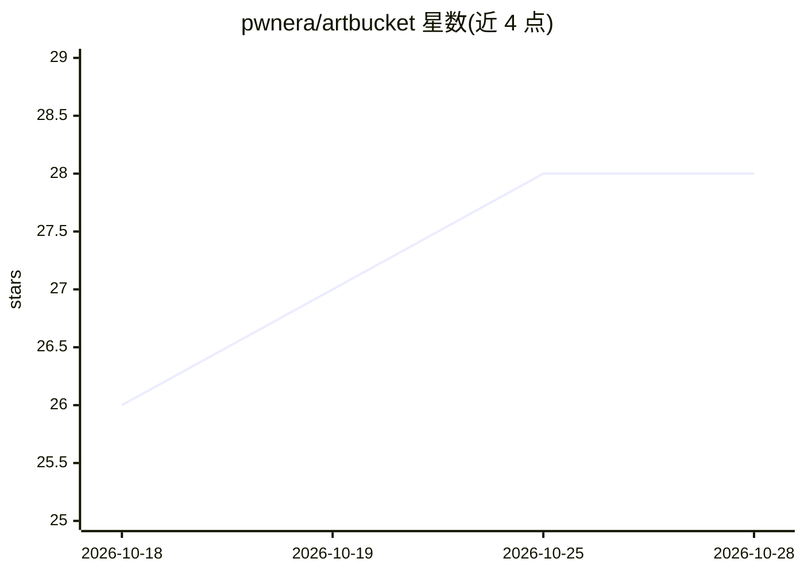

# pwnera/artbucket

⭐ 28 · TypeScript · AGPL-3.0 · 推送 2026-10-26 · [GitHub](https://github.com/pwnera/artbucket) · [官网](https://artbucket.io) · 组织维护

**自托管开源品牌资产管理系统，供团队与 AI agent 统一读取**

面向团队的 DAM（数字资产管理）与品牌管理平台：将资产、品牌规则、授权权利、发布版本集中在一个目录，人通过 Web 应用与门户访问，AI agent 通过 MCP 查询，代码通过 REST API、CLI 与 Git 消费同一数据。提供使用前合规检查（check_use）、按需尺寸/格式 rendition URL、资产级权限、审批流、C2PA 溯源与 Brand as code（YAML 存 Git）。自托管依赖 Node 22+、pnpm、Docker、Postgres 与 S3 兼容存储，AGPL-3.0 许可。

## 筛选速览

| 维度 | 判定 | 备注 |
|---|---|---|
| AI 角色 | `ai-enhanced` | 去掉 AI 部分产品仍成立 |
| 许可风险 | `viral` | AGPL-3.0 |
| 部署形态 | `self-host` | docker 或自建部署 |
| 模型依赖 | — | README 未给出锁定关系 |
| 硬件要求 | — | 无带数字的原话,不猜 |
| 安装摩擦 | `low` | 无编译、无系统依赖或容器化 |
| 成熟度 | — | 结构信号不足 |

## 能力要点

- 同一数据源同时服务人（Web/门户）、agent（MCP）与代码（REST/CLI/Git）
- 资产使用合规检查与授权管理（许可、渠道、地域、有效期）
- 10 万资产毫秒级搜索，单一原始文件生成任意尺寸/格式 URL
- C2PA 溯源读取与 IPTC/XMP 元数据回写，Brand as code 以 YAML 存 Git

## 适用场景

- 团队统一管理品牌资产、规范与授权，避免误用过期素材
- 让 AI agent 在生成内容前查询当前品牌资产并做使用合规检查
- 为合作伙伴、媒体构建品牌门户与 press kit 并自动校验资产有效性

## 场景标签

 · 领域:品牌资产管理/DAM

## 证据(README 行号)

> L15: Artbucket keeps a brand's assets, rules, rights and releases together, and
> L65: The whole core is here, free to self-host on Postgres and an S3-compatible

## 星数曲线

2026-10-18 26 → 2026-10-28 28（+2）

---
*卡片 v1 · prompt 1.4 · 生成 2026-10-26 · 置信度 high · 依据 README sha `d358f3983012` · [字段定义](../../DATASET.md)*
