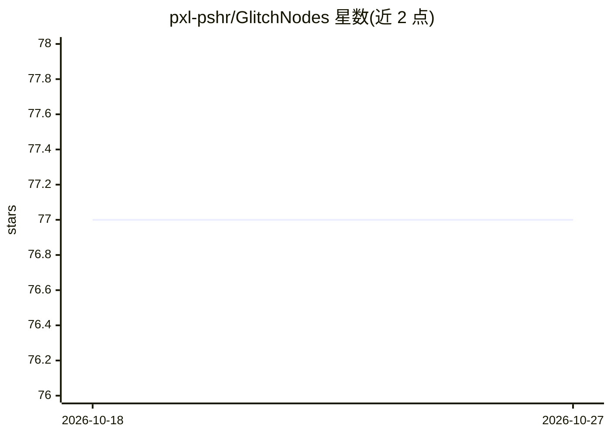

# pxl-pshr/GlitchNodes

⭐ 77 · Python · GPL-3.0 · 推送 2026-09-10 · [GitHub](https://github.com/pxl-pshr/GlitchNodes) · 个人维护

**ComfyUI 图像故障艺术与复古效果节点集（16 个节点）**

面向 ComfyUI 的图像处理节点集合，提供 16 个节点用于生成故障艺术与复古效果：包括复古像素化（Pixel8Bit，含 PICO-8/GameBoy/NES 等 17 种历史调色板与 K-Means 自适应量化）、小波变换受控损坏（Corruptor）、切片/色彩偏移（DataBend）、30 余种抖动算法（DitherMe、OrderedDithering）、JPEG 字节级损坏、VHS/CRT 模拟等。节点支持单张与批量图像及动画时序一致性。作者声明节点高度实验性，可能报错，欢迎贡献。

## 筛选速览

| 维度 | 判定 | 备注 |
|---|---|---|
| AI 角色 | `ai-ecosystem` | LLM/agent 周边工具 |
| 许可风险 | `viral` | GPL-3.0 |
| 部署形态 | `None` |  |
| 模型依赖 | — | README 未给出锁定关系 |
| 硬件要求 | — | 无带数字的原话,不猜 |
| 安装摩擦 | `low` | 无编译、无系统依赖或容器化 |
| 成熟度 | `idea` | |

## 能力要点

- 16 个故障/复古效果节点，覆盖像素化、损坏、抖动、CRT/VHS 模拟
- Pixel8Bit 内置 17 种历史硬件调色板（PICO-8/GameBoy/NES/C64 等）与自定义十六进制调色板
- DitherMe 提供 30 余种抖动算法（误差扩散、有序、聚类、几何曲线等）
- 支持单张与批量图像（N,H,W,C），抖动节点带动画时序一致性

## 适用场景

- 在 ComfyUI 工作流中为图像生成故障艺术与蒸汽波风格效果
- 将图像转为带历史调色板与抖动的 8 位复古风格
- 为动画序列生成时序一致的抖动效果

## 场景标签

`图像视频处理` · 领域:感知与多模态

## 证据(README 行号)

> L3: GlitchNodes is a collection of image processing nodes designed for ComfyUI that specializes in creating glitch art a
> L5: These are highly experimental and may break or even error. You are more than welcome to contribute to the repo.

## 星数曲线

2026-10-18 77 → 2026-10-27 77（+0）

---
*卡片 v1 · prompt 1.4 · 生成 2026-10-24 · 置信度 high · 依据 README sha `4edb5909b86f` · [字段定义](../../DATASET.md)*
