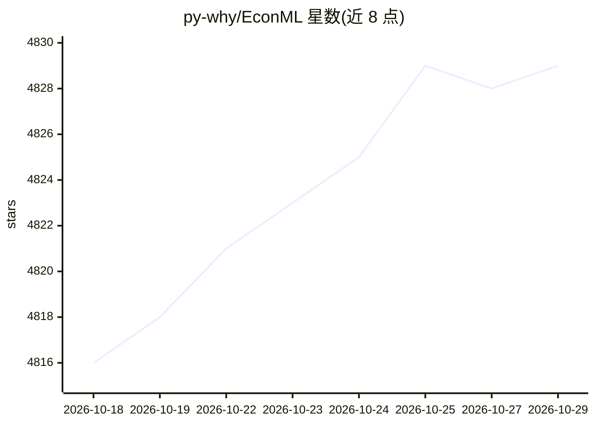

# py-why/EconML

⭐ 4,829 · Jupyter Notebook · NOASSERTION · 推送 2026-10-28 · [GitHub](https://github.com/py-why/EconML) · [官网](https://www.microsoft.com/en-us/research/project/alice/) · 组织维护

**微软研究院出品的异质性处理效应估计 Python 库（因果推断）**

EconML 是微软研究院 ALICE 项目的 Python 包，用机器学习方法从观测数据估计异质性处理效应（CATE），将计量经济学与随机森林、boosting、lasso、神经网络等技术结合。提供统一 API，实现 Double Machine Learning、因果森林、Meta-Learners（X/S/T）、Doubly Robust、工具变量等多种估计器，多数方法支持置信区间与推断结果（p 值、z 统计量）。另含树形/策略解释器、SHAP 值、RScorer 模型选择与双重稳健策略学习。面向做因果推断与处理效应分析的数据科学用户，部分方法要求无未观测混杂或工具变量假设。

## 筛选速览

| 维度 | 判定 | 备注 |
|---|---|---|
| AI 角色 | `ai-native` | 本体是模型或模型工具 |
| 许可风险 | `none` | NOASSERTION |
| 部署形态 | `library` | 以包/库形式分发 |
| 模型依赖 | — | README 未给出锁定关系 |
| 硬件要求 | — | 无带数字的原话,不猜 |
| 安装摩擦 | `low` | 无编译、无系统依赖或容器化 |
| 成熟度 | — | 结构信号不足 |

## 能力要点

- Double Machine Learning、Causal Forest、Meta-Learners、Doubly Robust、工具变量等多类估计器
- 统一 API，支持随机森林/boosting/lasso/神经网络建模拟合效应异质性
- 提供置信区间、p 值、z 统计量等推断输出
- 树形解释器、策略解释器、SHAP 值与因果模型选择（RScorer）、策略学习

## 适用场景

- 从观测数据估计干预对不同特征子群的因果效应
- 营销或策略分析中量化处理效应并生成置信区间
- 解释 CATE 模型并学习处理策略

## 场景标签

 · 领域:因果推断/计量经济学

## 证据(README 行号)

> L10: **EconML** is a Python package for estimating heterogeneous treatment effects from observational data via machine l
> L18: One of the biggest promises of machine learning is to automate decision making in a multitude of domains. At the co

## 星数曲线

2026-10-18 4,816 → 2026-10-29 4,829（+13）

---
*卡片 v1 · prompt 1.4 · 生成 2026-10-20 · 置信度 high · 依据 README sha `dfcc39f858bf` · [字段定义](../../DATASET.md)*
