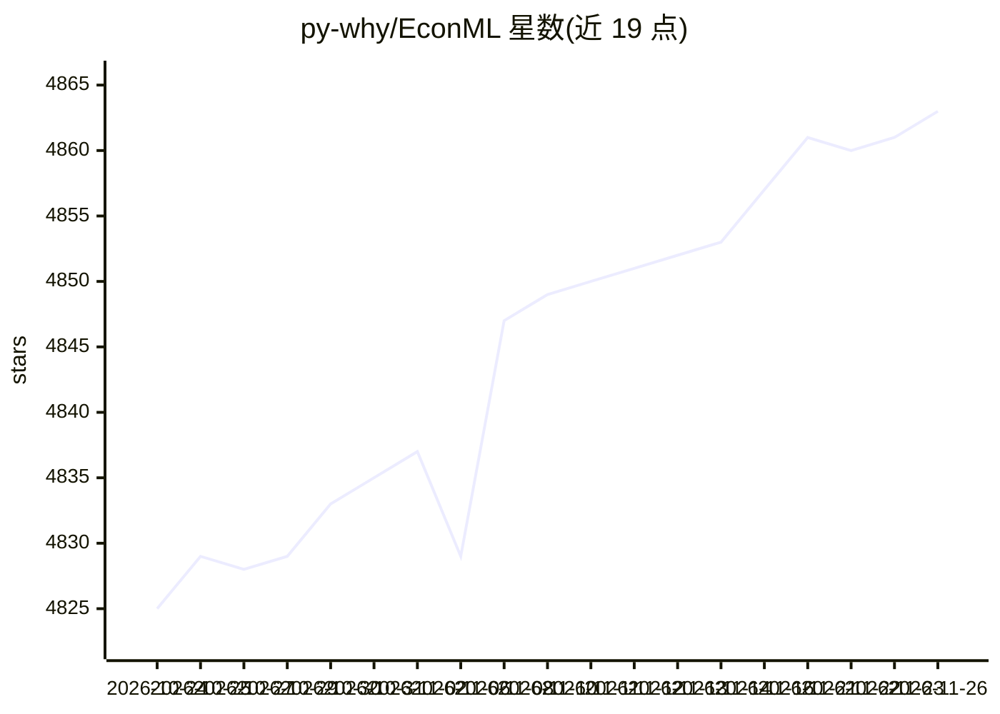

# py-why/EconML

⭐ 4,863 · Jupyter Notebook · NOASSERTION · 推送 2026-11-23 · [GitHub](https://github.com/py-why/EconML) · [官网](https://www.microsoft.com/en-us/research/project/alice/) · 组织维护

**从观测数据估计异质性处理效应的 Python 因果推断库**

Microsoft Research ALICE 项目下的 Python 包，用于结合机器学习与计量经济学方法、从观测数据估计异质性处理效应。实现 Double Machine Learning、Causal Forests、正交随机森林、Meta-Learners、Doubly Robust Learner 及工具变量方法，多数方法提供置信区间与推断结果（p 值、z 统计量）。另含 CATE 模型的树解释器、策略解释器、SHAP 支持与离线策略学习模块，统一 API 构建，可通过 pip 安装。

## 筛选速览

| 维度 | 判定 | 备注 |
|---|---|---|
| AI 角色 | `ai-native` | 本体是模型或模型工具 |
| 许可风险 | `none` | NOASSERTION |
| 部署形态 | `library` | 以包/库形式分发 |
| 模型依赖 | — | README 未给出锁定关系 |
| 硬件要求 | — | 无带数字的原话,不猜 |
| 安装摩擦 | `low` | 无编译、无系统依赖或容器化 |
| 成熟度 | — | 结构信号不足 |

## 能力要点

- 实现 DML、Causal Forests、正交随机森林、Meta-Learners 等处理效应估计方法
- 支持工具变量（IV）下的 DML 与双重稳健估计
- 提供 CATE 树解释器、策略解释器与 SHAP 值可解释性
- 统一 API，兼容 sklearn 模型选择与估计器

## 适用场景

- 估计干预对具有特定特征的样本的因果效应
- 基于处理效应模型生成个性化推荐处理策略
- 对因果效应模型进行可解释性分析与统计推断

## 场景标签

`数据分析` `科研工具` · 领域:效率与自动化

## 证据(README 行号)

> L10: **EconML** is a Python package for estimating heterogeneous treatment effects from observational data via machine l
> L14: * Maintain flexibility in modeling the effect heterogeneity (via techniques such as random forests, boosting, lasso

## 星数曲线

2026-10-24 4,825 → 2026-11-26 4,863（+38）

---
*卡片 v1 · prompt 1.4 · 生成 2026-11-22 · 置信度 high · 依据 README sha `274f7011a28e` · [字段定义](../../DATASET.md)*
