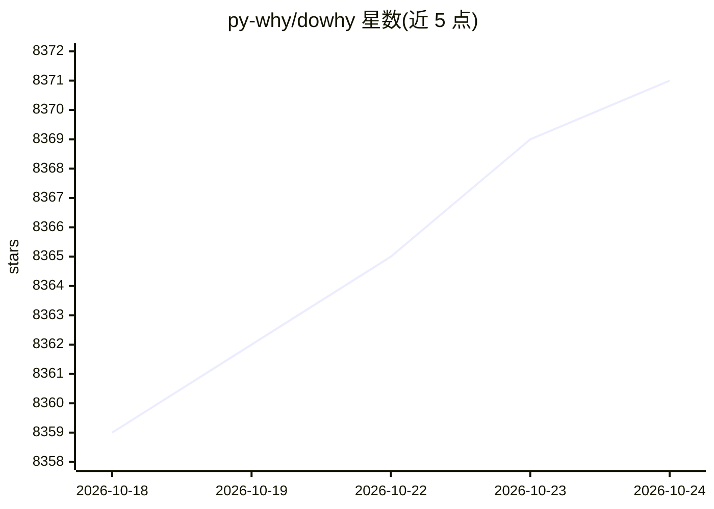

# py-why/dowhy

⭐ 8,371 · Python · MIT · 推送 2026-10-23 · [GitHub](https://github.com/py-why/dowhy) · [官网](https://www.pywhy.org/dowhy) · 组织维护

**面向因果推断的 Python 库：建模、估计与检验因果假设**

DoWhy 是 PyWhy 生态下的因果推断 Python 库，为数据科学与机器学习用户提供统一接口完成因果推理各步骤：结合图因果模型与潜在结果两种框架，通过 do-calculus 与图判据识别因果效应，再用统计方法估计；提供反驳/证伪 API 对任意估计方法的因果假设做稳健性检验。支持效应估计、因果影响量化、反事实与干预分析、根因归因等任务。可用 pip/poetry/conda 安装，并支持接入 EconML 的 CATE 估计方法。

## 筛选速览

| 维度 | 判定 | 备注 |
|---|---|---|
| AI 角色 | `ai-native` | 本体是模型或模型工具 |
| 许可风险 | `permissive` | MIT |
| 部署形态 | `library` | 以包/库形式分发 |
| 模型依赖 | — | README 未给出锁定关系 |
| 硬件要求 | — | 无带数字的原话,不猜 |
| 安装摩擦 | `low` | 无编译、无系统依赖或容器化 |
| 成熟度 | — | 结构信号不足 |

## 能力要点

- 统一图因果模型与潜在结果两套框架，model-identify-estimate-refute 四步流程
- 反驳/证伪 API 可对任意估计方法检验因果假设
- 支持效应估计、中介分析、反事实、干预模拟、根因归因等任务
- 可调用 EconML 的 CATE 估计方法（如 backdoor.econml.dml.DML）

## 适用场景

- 估计某干预（如会员计划）对结果的因果效应并做稳健性检验
- 将异常或分布变化归因到具体变量做根因分析
- 做 what-if 反事实与干预模拟分析

## 场景标签

 · 领域:因果机器学习/数据科学

## 证据(README 行号)

> L38: Decision-making involves understanding how different variables affect each other and predicting the outcome when so
> L40: DoWhy provides a wide variety of algorithms for effect estimation, prediction, quantification
> L67: - Effect estimation (identification, average causal effect, conditional average causal effect, instrumental variabl

## 星数曲线

2026-10-18 8,359 → 2026-10-24 8,371（+12）

---
*卡片 v1 · prompt 1.4 · 生成 2026-10-20 · 置信度 high · 依据 README sha `0b42c3e0477c` · [字段定义](../../DATASET.md)*
