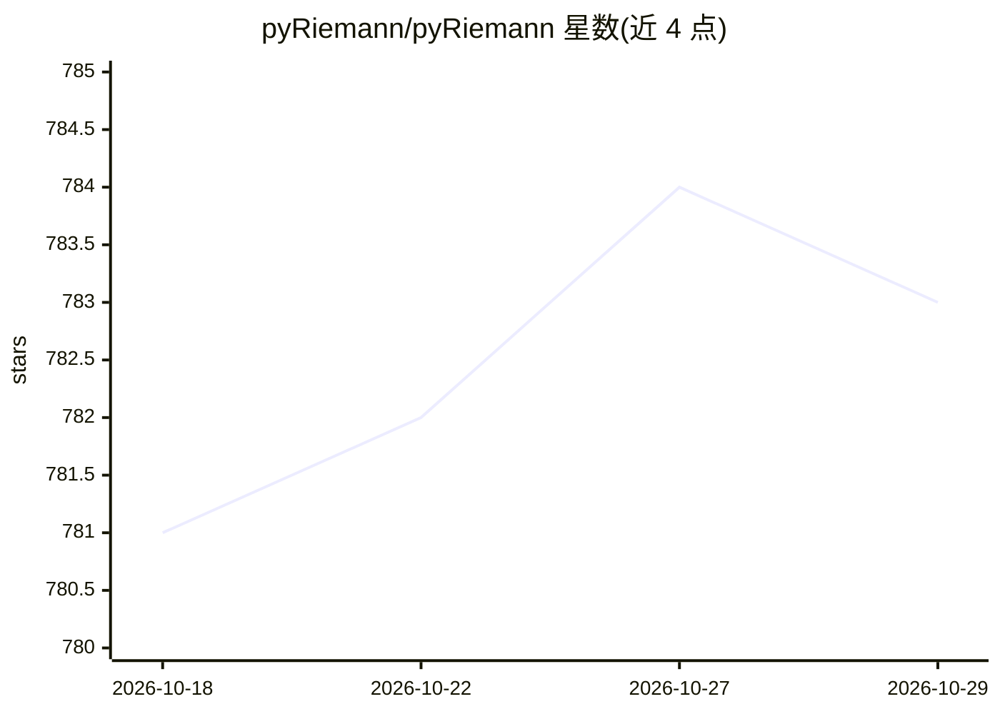

# pyRiemann/pyRiemann

⭐ 783 · Python · BSD-3-Clause · 推送 2026-10-27 · [GitHub](https://github.com/pyRiemann/pyRiemann) · [官网](https://pyriemann.readthedocs.io) · 组织维护

**基于黎曼几何的多变量数据（EEG/BCI/遥感）机器学习库**

基于 scikit-learn API 的 Python 机器学习包，通过对称（Hermitian）正定矩阵的黎曼几何处理实/复值多变量数据的分类。面向生物信号（EEG/MEG/EMG）与脑机接口（BCI）设计，支持运动想象、ERP、SSVEP 范式及跨会话/跨被试迁移学习；另支持遥感应用（高光谱图像用 SPD 矩阵、SAR 图像用 HPD 矩阵）。核心函数经 Python Array API 透明支持 NumPy 与 PyTorch 后端，传入 PyTorch 张量可获得可选 GPU 加速与自动微分。BSD 3 条款许可，经 PyPI、conda-forge 分发。

## 筛选速览

| 维度 | 判定 | 备注 |
|---|---|---|
| AI 角色 | `ai-native` | 本体是模型或模型工具 |
| 许可风险 | `permissive` | BSD-3-Clause |
| 部署形态 | `library` | 以包/库形式分发 |
| 模型依赖 | — | README 未给出锁定关系 |
| 硬件要求 | — | 无带数字的原话,不猜 |
| 安装摩擦 | `low` | 无编译、无系统依赖或容器化 |
| 成熟度 | — | 结构信号不足 |

## 能力要点

- SPD/HPD 矩阵黎曼几何下的协方差估计与分类
- 支持 BCI 范式：运动想象、ERP、SSVEP 及迁移学习
- NumPy/PyTorch 双后端，可选 GPU 加速与 autograd
- 遵循 scikit-learn API，可直接用于 sklearn 流水线

## 适用场景

- 对 EEG 等生物信号做协方差估计与分类
- 构建 BCI 解码流水线（MDM、切空间+SVM 等）
- 对高光谱/SAR 雷达图像做遥感分析

## 场景标签

 · 领域:神经工程/脑机接口/遥感

## 证据(README 行号)

> L11: pyRiemann is a Python machine learning package based on scikit-learn API.
> L23: but has been designed around biosignals (like EEG, MEG or EMG)
> L39: pyRiemann's core utility functions support both NumPy and PyTorch backends

## 星数曲线

2026-10-18 781 → 2026-10-29 783（+2）

---
*卡片 v1 · prompt 1.4 · 生成 2026-10-21 · 置信度 high · 依据 README sha `3eed37c43f7c` · [字段定义](../../DATASET.md)*
