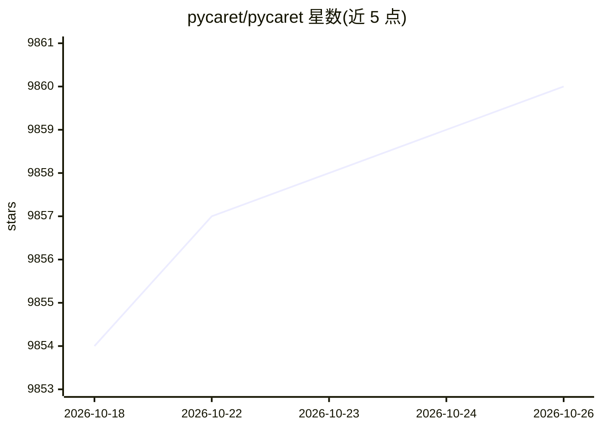

# pycaret/pycaret

⭐ 9,860 · Python · NOASSERTION · 推送 2026-07-23 · [GitHub](https://github.com/pycaret/pycaret) · [官网](https://pycaret.org) · 组织维护

**自托管开源 AutoML 平台：训练、注册、部署模型一体化**

PyCaret 4.0 提供三部分：基于 sklearn-1.7 的 AutoML 引擎库（PyPI 发布为 pycaret）、FastAPI 控制平面（工作区、项目、实验、运行、模型注册、部署、监控、漂移、血缘、定时任务、LLM 顾问 copilot），以及 React + Vite 的 Web UI。用户通过 docker compose 一键本地部署，完成数据集上传→训练约 12 种算法→排行榜选优→注册→部署→API 预测的完整流程。当前形态为双容器单机部署（SQLite 存储），架构计划通过 Protocol 抽象拆分到云后端。4.0 线为进行中，3.x 已冻结在 3.4.0。

## 筛选速览

| 维度 | 判定 | 备注 |
|---|---|---|
| AI 角色 | `ai-native` | 本体是模型或模型工具 |
| 许可风险 | `none` | NOASSERTION |
| 部署形态 | `self-host` | docker 或自建部署 |
| 模型依赖 | — | README 未给出锁定关系 |
| 硬件要求 | — | 无带数字的原话,不猜 |
| 安装摩擦 | `low` | 无编译、无系统依赖或容器化 |
| 成熟度 | `idea` | |

## 能力要点

- sklearn-1.7 AutoML 引擎 + FastAPI 控制平面 + React Web UI 三合一
- docker compose 一键本地部署，约 10 分钟完成训练→注册→部署→预测闭环
- 支持分类/回归/聚类/异常检测/时间序列任务，单次运行训练约 12 种算法
- 可选接入 Anthropic/OpenAI API 启用数据集顾问与实验设计 copilot

## 适用场景

- 在本地快速完成端到端的 AutoML 实验与模型对比
- 把训练好的模型注册并部署为预测 API 端点
- 小团队自托管机器学习平台，通过 Web UI 点选配置

## 场景标签

`MLOps` · 领域:训练与推理

## 证据(README 行号)

> L27: - **Engine** — sklearn-1.7-based AutoML library (`pycaret` on PyPI).
> L28: - **Control plane** — FastAPI backend with workspaces, projects, experiments, runs, model registry, deployments, ap
> L108: 5. **Run an experiment** — inside the project → New experiment → pick your dataset, pick the task type (classifica

## 星数曲线

2026-10-18 9,854 → 2026-10-26 9,860（+6）

---
*卡片 v1 · prompt 1.4 · 生成 2026-10-20 · 置信度 mid · 依据 README sha `c18e757e6f4a` · [字段定义](../../DATASET.md)*
