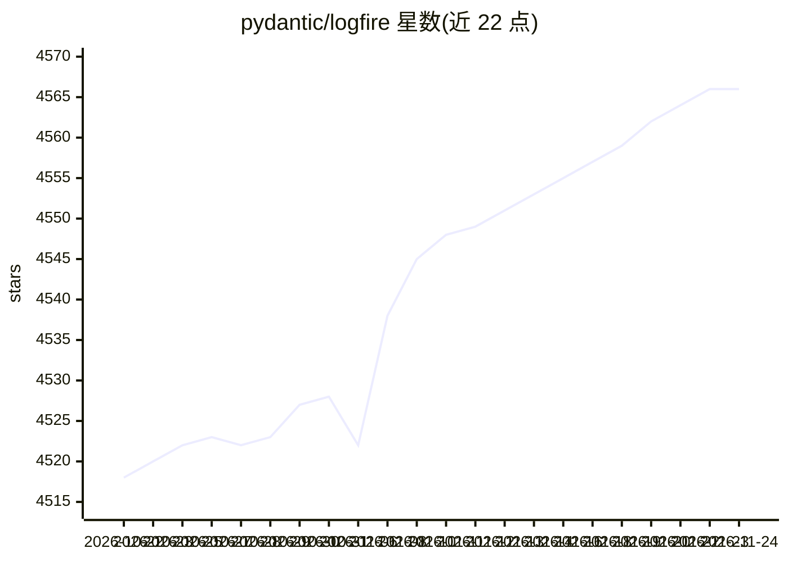

# pydantic/logfire

⭐ 4,566 · Python · MIT · 推送 2026-11-22 · [GitHub](https://github.com/pydantic/logfire) · [官网](https://pydantic.dev/logfire/) · 组织维护

**面向 LLM 与 agent 生产系统的 OpenTelemetry 可观测性平台（Python SDK 开源）**

由 Pydantic 团队提供的可观测性平台：本仓库包含 Python SDK 与文档，服务端（记录与展示数据的 UI/后端）闭源，需购买企业许可方可自托管。SDK 是 OpenTelemetry 的封装，支持 traces、metrics、logs 三种信号，可将数据导出到任意 OTel 兼容后端；提供 SQL 查询、Pydantic 模型验证分析、与 FastAPI 等常用包的自动集成，覆盖 LLM 应用、agent 与生产 evals 场景。通过 pip 安装，经 logfire-cli 认证并初始化项目。

## 筛选速览

| 维度 | 判定 | 备注 |
|---|---|---|
| AI 角色 | `ai-ecosystem` | LLM/agent 周边工具 |
| 许可风险 | `permissive` | MIT |
| 部署形态 | `library` | 以包/库形式分发 |
| 模型依赖 | — | README 未给出锁定关系 |
| 硬件要求 | — | 无带数字的原话,不猜 |
| 安装摩擦 | `low` | 无编译、无系统依赖或容器化 |
| 成熟度 | — | 结构信号不足 |

## 能力要点

- 基于 OpenTelemetry 的封装，支持 traces/metrics/logs 全部信号，可导出到任意 OTel 兼容后端
- 标准 SQL 查询数据，可配合现有 BI 工具
- 与 Pydantic Validation 集成，提供模型验证分析
- 支持 FastAPI 等流行 Python 包的自动 instrumentation

## 适用场景

- 为生产环境的 LLM 应用和 agent 接入追踪与监控
- 在产线上运行 evals 并观测 Python 应用行为
- 用 SQL 和现有 BI 工具查询遥测数据

## 场景标签

`LLM 可观测性` · 领域:评测与运维

## 证据(README 行号)

> L16: - **OpenTelemetry:** Logfire is an opinionated wrapper around OpenTelemetry, allowing you to leverage existing tool
> L25: This repo contains the Python SDK for `logfire` and documentation; the server application for recording and display
> L96: The Logfire platform (the UI and backend) is closed source. You can self-host it by purchasing an enterprise licens

## 星数曲线

2026-10-22 4,518 → 2026-11-24 4,566（+48）

---
*卡片 v1 · prompt 1.4 · 生成 2026-11-22 · 置信度 high · 依据 README sha `ad3e627dbf95` · [字段定义](../../DATASET.md)*
