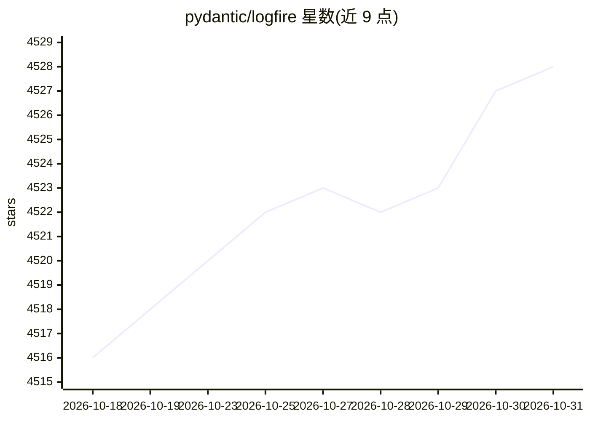

# pydantic/logfire

⭐ 4,528 · Python · MIT · 推送 2026-10-30 · [GitHub](https://github.com/pydantic/logfire) · [官网](https://pydantic.dev/logfire/) · 组织维护

**面向 Python/LLM 应用的可观测性平台：日志、追踪、指标与评测**

Pydantic 团队开发的可观测性平台：本仓库包含 Python SDK 与文档，服务端（数据记录与展示）闭源。SDK 基于 OpenTelemetry 封装，支持 traces、metrics、logs 全部信号，提供 SQL 查询、Python 对象展示、事件循环遥测、代码与数据库查询分析，以及对 Pydantic 模型校验数据的内建分析；面向 LLM 应用、agent 与生产环境评测场景。通过 pip 安装 SDK 与 CLI，可自动插桩 FastAPI 等常用包，也可将数据导出到任意 OTel 兼容后端。

## 筛选速览

| 维度 | 判定 | 备注 |
|---|---|---|
| AI 角色 | `ai-ecosystem` | LLM/agent 周边工具 |
| 许可风险 | `permissive` | MIT |
| 部署形态 | `library` | 以包/库形式分发 |
| 模型依赖 | — | README 未给出锁定关系 |
| 硬件要求 | — | 无带数字的原话,不猜 |
| 安装摩擦 | `low` | 无编译、无系统依赖或容器化 |
| 成熟度 | — | 结构信号不足 |

## 能力要点

- OpenTelemetry 封装，支持 traces/metrics/logs 全部信号并可导出到任意 OTel 兼容后端
- Python 对象展示、事件循环遥测、代码与数据库查询分析
- Pydantic 模型校验数据内建分析
- 提供 FastAPI 等常用包的自动插桩集成

## 适用场景

- 追踪生产环境 Python 应用的日志与调用链
- 观测 LLM 应用与 agent 的运行行为并进行评测
- 用 SQL 查询遥测数据并接入现有 BI 工具

## 场景标签

`LLM 可观测性` `模型评测` · 领域:评测与运维

## 证据(README 行号)

> L16: - **OpenTelemetry:** Logfire is an opinionated wrapper around OpenTelemetry, allowing you to leverage existing tool
> L21: Evaluating observability tools? See what Logfire does for LLM apps and agents, evals in production, and how it comp
> L25: This repo contains the Python SDK for `logfire` and documentation; the server application for recording and display

## 星数曲线

2026-10-18 4,516 → 2026-10-31 4,528（+12）

---
*卡片 v1 · prompt 1.4 · 生成 2026-10-20 · 置信度 high · 依据 README sha `03cc242f264b` · [字段定义](../../DATASET.md)*
