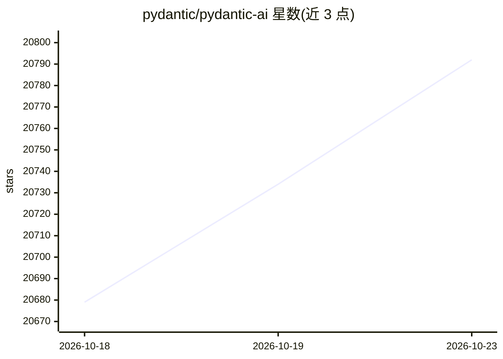

# pydantic/pydantic-ai

⭐ 20,792 · Python · MIT · 推送 2026-10-22 · [GitHub](https://github.com/pydantic/pydantic-ai) · [官网](https://pydantic.dev/pydantic-ai) · 组织维护

**面向 Python 开发者的类型安全 AI Agent SDK**

Pydantic 团队出品的 Python AI SDK，核心是带类型标注的可扩展 agent 循环：结构化输出、依赖注入与工具参数校验由 Pydantic 类型系统保证。同一 agent 定义可运行于终端 CLI、Web 聊天、实时语音会话、持久化后台队列或 GitHub Actions。配套 Harness 能力库提供记忆、护栏、子 agent、规划等能力；另有 Evals 评估、Graph 控制流、OpenTelemetry 原生可观测性。安装经 PyPI/uv，无需编译，内置 'test' 模型可不带 API key 起步。

## 筛选速览

| 维度 | 判定 | 备注 |
|---|---|---|
| AI 角色 | `ai-native` | 本体是模型或模型工具 |
| 许可风险 | `permissive` | MIT |
| 部署形态 | `library` | 以包/库形式分发 |
| 模型依赖 | local-ok | 支持本地模型 |
| 硬件要求 | — | 无带数字的原话,不猜 |
| 安装摩擦 | `low` | 无编译、无系统依赖或容器化 |
| 成熟度 | — | 结构信号不足 |

## 动量与使用信号

- 维护:`active` — 距上次 push 0.7 天,年发版 100,475 位贡献者
- 涨星:近 1 天 **+25**(自 20261016 起算)
- 平台:— · 协议:MCP / OLLAMA

## 能力要点

- 任意模型通过字符串切换，统一 Python API（OpenAI、Anthropic、Google、Bedrock、Ollama 等数十家）
- 类型端到端：结构化输出、类型化依赖注入与工具 schema 校验
- 九种持久化执行引擎（Temporal、DBOS、Prefect、Restate、AWS Lambda 等），支持人审
- 实时语音（OpenAI Realtime、Gemini Live、Azure、xAI Grok Voice）与图像生成同栈提供

## 适用场景

- 用 Python 构建带类型校验的结构化数据抽取 pipeline
- 搭建需要长时运行、可从崩溃恢复的多 agent 工作流
- 在终端或 GitHub Actions 中运行编码 agent
- 为同一 agent 增加实时语音对话前端

## 场景标签

`Agent 框架` `多智能体` `模型评测` · 领域:Agent 开发

## 证据(README 行号)

> L18: **Pydantic AI** is the Python AI SDK: a typed, extensible agent loop with every model a string swap away. The same 
> L157: - **Any model, one Python API.** Virtually every model and provider (OpenAI, Anthropic, Google, Bedrock, Azure AI 
> L163: - **Batteries, composably.** One primitive, the capability, bundles tools, instructions, hooks, and model settings

## 星数曲线

2026-10-18 20,679 → 2026-10-23 20,792（+113）

---
*卡片 v1 · prompt 1.4 · 生成 2026-10-18 · 置信度 high · 依据 README sha `96552837b32c` · [字段定义](../../DATASET.md)*
