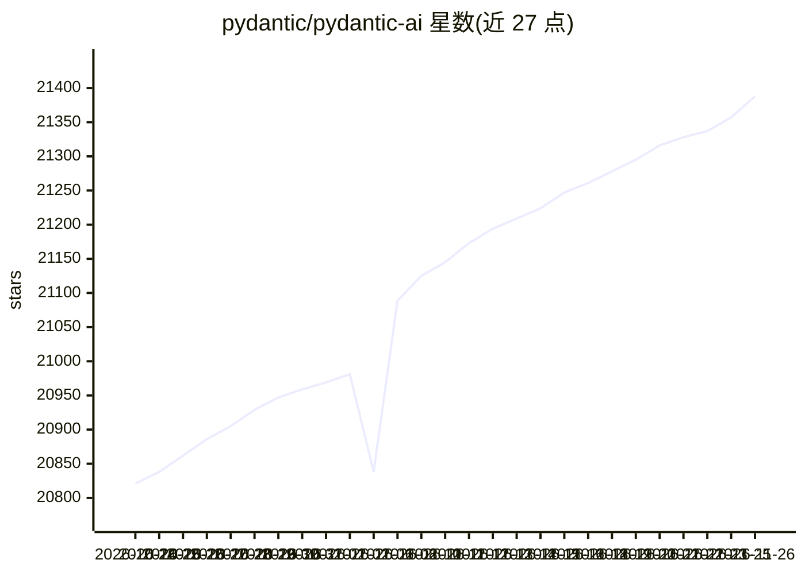

# pydantic/pydantic-ai

⭐ 21,388 · Python · MIT · 推送 2026-11-25 · [GitHub](https://github.com/pydantic/pydantic-ai) · [官网](https://pydantic.dev/pydantic-ai) · 组织维护

**Python AI agent 框架：类型安全的模型接入与运行**

Pydantic AI 是一个 Python AI SDK，提供类型化的 agent 循环，支持切换模型字符串更换供应商并配置 fallback。同一 agent 可运行于 Web 前端、终端、语音通话、后台队列、GitHub Actions 等接口。配套 Pydantic AI Harness 提供记忆、护栏、子 agent、持久化等能力组件，另有 Evals 评测、Graph 控制流、Logfire 观测与 AI Gateway 网关等独立包。安装方式为 uv/pip 添加 PyPI 包。

## 筛选速览

| 维度 | 判定 | 备注 |
|---|---|---|
| AI 角色 | `ai-ecosystem` | LLM/agent 周边工具 |
| 许可风险 | `permissive` | MIT |
| 部署形态 | `library` | 以包/库形式分发 |
| 模型依赖 | — | README 未给出锁定关系 |
| 硬件要求 | — | 无带数字的原话,不猜 |
| 安装摩擦 | `low` | 无编译、无系统依赖或容器化 |
| 成熟度 | — | 结构信号不足 |

## 动量与使用信号

- 维护:`active` — 距上次 push 0.7 天,年发版 100,475 位贡献者
- 涨星:近 1 天 **+25**(自 20261016 起算)
- 平台:— · 协议:MCP / OLLAMA

## 能力要点

- 类型化端到端：结构化输出、类型化依赖注入与工具，返回类型经校验保证
- 一个 Python API 接入多家模型供应商，字符串即可切换，内置 failover
- 九种持久化执行引擎（Temporal、DBOS、Prefect 等）支持长时运行恢复
- Realtime 语音（OpenAI Realtime、Gemini Live 等）与图像生成在同一 SDK 内

## 适用场景

- 用类型约束构建结构化数据抽取 agent
- 在终端运行完整编码 agent（Coder/Pax）
- 把 agent 部署到 Temporal 等持久化工作流中长期运行
- 为 agent 应用接入 OpenTelemetry 观测与成本追踪

## 场景标签

`Agent 框架` `模型评测` `编码 Agent` · 领域:Agent 开发

## 证据(README 行号)

> L18: **Pydantic AI** is the Python AI SDK: a typed, extensible agent loop with every model a string swap away, and anoth
> L22: Pydantic Evals grades an agent's final outputs and tool-call trajectories, on datasets or live production traffic, 
> L158: - **Any model, one Python API.** Virtually every model and provider (OpenAI, Anthropic, Google, Bedrock, Azure AI 

## 星数曲线

2026-10-24 20,821 → 2026-11-26 21,388（+567）

---
*卡片 v1 · prompt 1.4 · 生成 2026-11-26 · 置信度 high · 依据 README sha `5e561d64a74b` · [字段定义](../../DATASET.md)*
