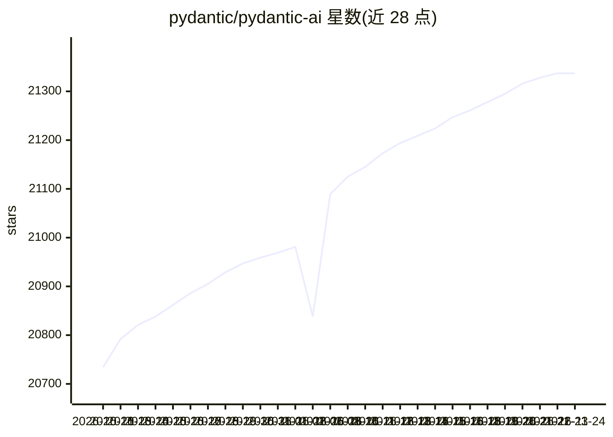

# pydantic/pydantic-ai

⭐ 21,337 · Python · MIT · 推送 2026-11-22 · [GitHub](https://github.com/pydantic/pydantic-ai) · [官网](https://pydantic.dev/pydantic-ai) · 组织维护

**Python AI Agent SDK：类型安全地构建与运行多模型 Agent**

Pydantic AI 提供 Python 形式的 Agent 开发套件：类型化的 Agent 循环、函数工具、结构化输出、依赖注入，并附带实时语音、图像生成与 embeddings 接口。通过 capability 机制组合工具与指令，Pydantic AI Harness 提供记忆、子 Agent、规划、持久化等扩展能力。支持九种持久执行引擎（Temporal/DBOS/Prefect 等），以 OpenTelemetry 提供可观测性，配套 Evals 评测与 Gateway 网关。面向构建 AI 应用的 Python 开发者，安装依赖 PyPI 包管理（uv/pip）。

## 筛选速览

| 维度 | 判定 | 备注 |
|---|---|---|
| AI 角色 | `ai-ecosystem` | LLM/agent 周边工具 |
| 许可风险 | `permissive` | MIT |
| 部署形态 | `library` | 以包/库形式分发 |
| 模型依赖 | — | README 未给出锁定关系 |
| 硬件要求 | — | 无带数字的原话,不猜 |
| 安装摩擦 | `low` | 无编译、无系统依赖或容器化 |
| 成熟度 | — | 结构信号不足 |

## 动量与使用信号

- 维护:`active` — 距上次 push 0.7 天,年发版 100,475 位贡献者
- 涨星:近 1 天 **+25**(自 20261016 起算)
- 平台:— · 协议:MCP / OLLAMA

## 能力要点

- 类型化的 Agent 循环：结构化输出、依赖注入、工具参数校验
- 模型与提供商以字符串切换并支持失败回退
- capability 组合机制与 Harness 能力库（Coder/Researcher 等完整 Agent）
- 九种持久执行引擎与 OpenTelemetry 原生可观测性

## 适用场景

- 在 Python 应用中构建带工具调用与类型校验的 Agent
- 在后台队列中运行可恢复、可持久化的长任务 Agent
- 给同一 Agent 接入命令行、Web 聊天或实时语音界面
- 对 Agent 的输出与工具调用轨迹做数据集或线上评测

## 场景标签

`Agent 框架` `模型评测` · 领域:Agent 开发

## 证据(README 行号)

> L18: **Pydantic AI** is the Python AI SDK: a typed, extensible agent loop with every model a string swap away, and anoth
> L22: Pydantic Evals grades an agent's final outputs and tool-call trajectories, on datasets or live production traffic, 
> L157: - **Any model, one Python API.** Virtually every model and provider (OpenAI, Anthropic, Google, Bedrock, Azure AI 

## 星数曲线

2026-10-21 20,734 → 2026-11-24 21,337（+603）

---
*卡片 v1 · prompt 1.4 · 生成 2026-11-23 · 置信度 high · 依据 README sha `9b68c492c4b8` · [字段定义](../../DATASET.md)*
