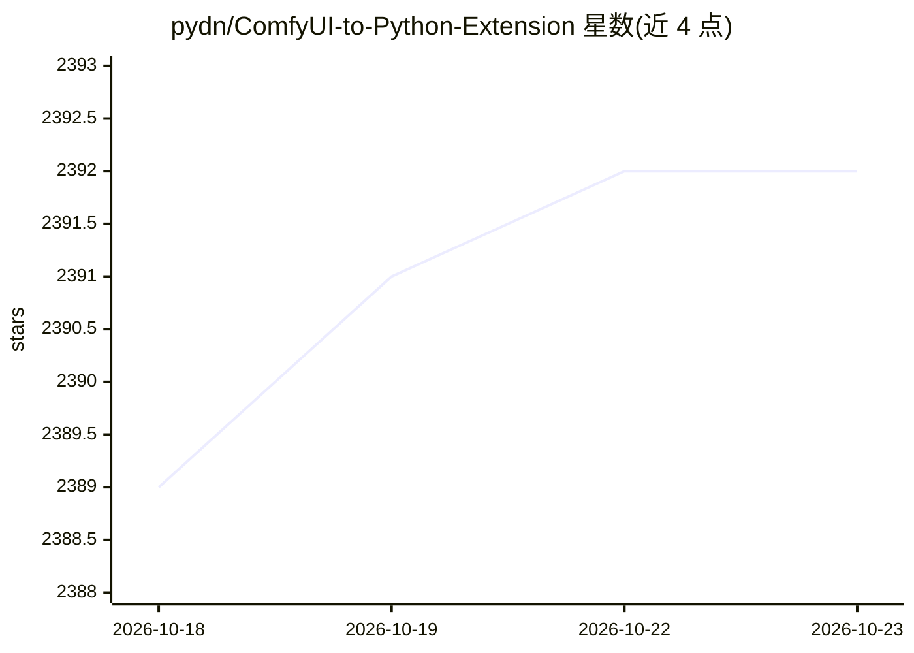

# pydn/ComfyUI-to-Python-Extension

⭐ 2,392 · Python · MIT · 推送 2026-05-10 · [GitHub](https://github.com/pydn/ComfyUI-to-Python-Extension) · 个人维护

**将 ComfyUI 可视化工作流导出为可执行 Python 脚本的扩展**

作为 ComfyUI 的 custom_nodes 扩展或独立 CLI 工具，把 API 格式的工作流 JSON 转换为可直接运行的 Python 脚本，用于自动化、实验与可复现生成。提供 Web UI 的 File->Save As Script 导出和命令行导出两种方式。生成的脚本依赖可用的 ComfyUI 运行时（通过 COMFYUI_PATH 定位），复用 ComfyUI 的参数解析器，可传递 --cpu/--lowvram 等内存标志；脚本为单次执行的工作流运行器，不做结果缓存。要求 Python 3.12 及以上。

## 筛选速览

| 维度 | 判定 | 备注 |
|---|---|---|
| AI 角色 | `ai-ecosystem` | LLM/agent 周边工具 |
| 许可风险 | `permissive` | MIT |
| 部署形态 | `desktop` | 安装包/桌面程序 |
| 模型依赖 | — | README 未给出锁定关系 |
| 硬件要求 | — | 无带数字的原话,不猜 |
| 安装摩擦 | `low` | 无编译、无系统依赖或容器化 |
| 成熟度 | — | 结构信号不足 |

## 能力要点

- Web UI 内 File->Save As Script 一键导出 .py 脚本
- CLI 转换已保存的 API 格式工作流（可设 queue_size 等参数）
- 生成脚本支持 ComfyUI 内存标志（--cpu/--lowvram 等）与模型卸载选项
- 导出脚本包含工作流元数据，图片可拖回 ComfyUI 重开工作流

## 适用场景

- 把 ComfyUI 里搭好的生成流程转成脚本接入自动化流水线
- 脱离 Web UI 批量、可复现地重复运行图像生成工作流
- 将工作流嵌入其他 Python 程序中调用

## 场景标签

`图像生成` · 领域:内容生成

## 证据(README 行号)

> L7: `ComfyUI-to-Python-Extension` turns visual workflows into executable scripts so you can move from node graphs to aut
> L136: Generated scripts depend on a working ComfyUI runtime.

## 星数曲线

2026-10-18 2,389 → 2026-10-23 2,392（+3）

---
*卡片 v1 · prompt 1.4 · 生成 2026-10-21 · 置信度 high · 依据 README sha `3539fa9ef0cf` · [字段定义](../../DATASET.md)*
