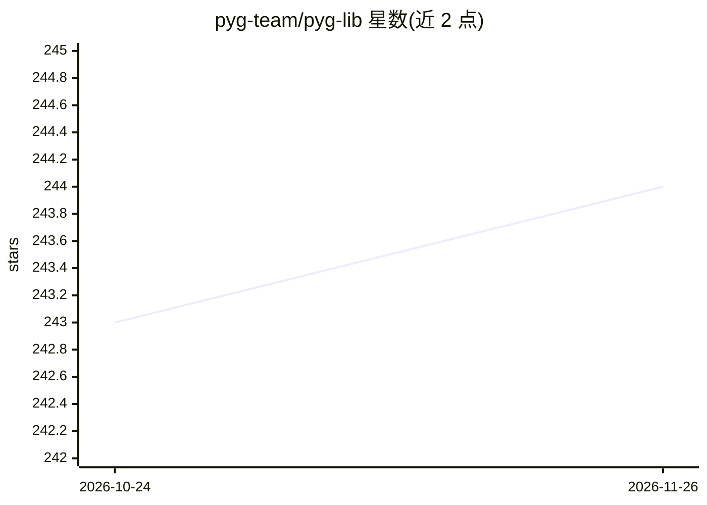

# pyg-team/pyg-lib

⭐ 244 · C++ · NOASSERTION · 推送 2026-11-23 · [GitHub](https://github.com/pyg-team/pyg-lib) · [官网](https://pyg-lib.readthedocs.io) · 组织维护

**PyG 的低层图神经网络算子库**

pyg-lib 是 PyG（PyTorch Geometric）生态中的低层图神经网络算子库，以 C++/CUDA 实现核心算子，供上层 PyG 库调用。通过预编译 Python wheel 覆盖主流 OS/PyTorch/CUDA 组合，wheel 采用 CPython stable ABI，支持 CPython 3.11–3.14，并用 abi3audit 在 CI 中校验。安装方式包括 pip 预编译 wheel（按 torch 与 cpu/cu130/cu132 组合选择索引）、Linux nightly wheel 及源码编译。

## 筛选速览

| 维度 | 判定 | 备注 |
|---|---|---|
| AI 角色 | `ai-native` | 本体是模型或模型工具 |
| 许可风险 | `none` | NOASSERTION |
| 部署形态 | `library` | 以包/库形式分发 |
| 模型依赖 | — | README 未给出锁定关系 |
| 硬件要求 | — | 无带数字的原话,不猜 |
| 安装摩擦 | `high` | 编译与系统依赖俱全 |
| 成熟度 | — | 结构信号不足 |

## 能力要点

- 提供覆盖 Linux/Windows/macOS 的预编译 wheel，支持 PyTorch 2.12–2.15 与 cpu/cu130/cu132 组合
- wheel 使用 CPython stable ABI，支持 CPython 3.11–3.14，CI 用 abi3audit 校验
- 提供 Linux nightly wheel 与源码编译安装路径

## 适用场景

- 为 PyTorch 环境安装 PyG 的低层图算子依赖
- 在特定 PyTorch/CUDA 组合下部署图神经网络训练环境
- 从源码编译参与库的开发与贡献

## 场景标签

 · 领域:深度学习/图神经网络

## 证据(README 行号)

> L10: We provide pre-built Python wheels for all major OS/PyTorch/CUDA
> L18: pip install pyg-lib -f https://data.pyg.org/whl/torch-${TORCH}+${CUDA}.html

## 星数曲线

2026-10-24 243 → 2026-11-26 244（+1）

---
*卡片 v1 · prompt 1.4 · 生成 2026-11-25 · 置信度 high · 依据 README sha `6002df6178b6` · [字段定义](../../DATASET.md)*
