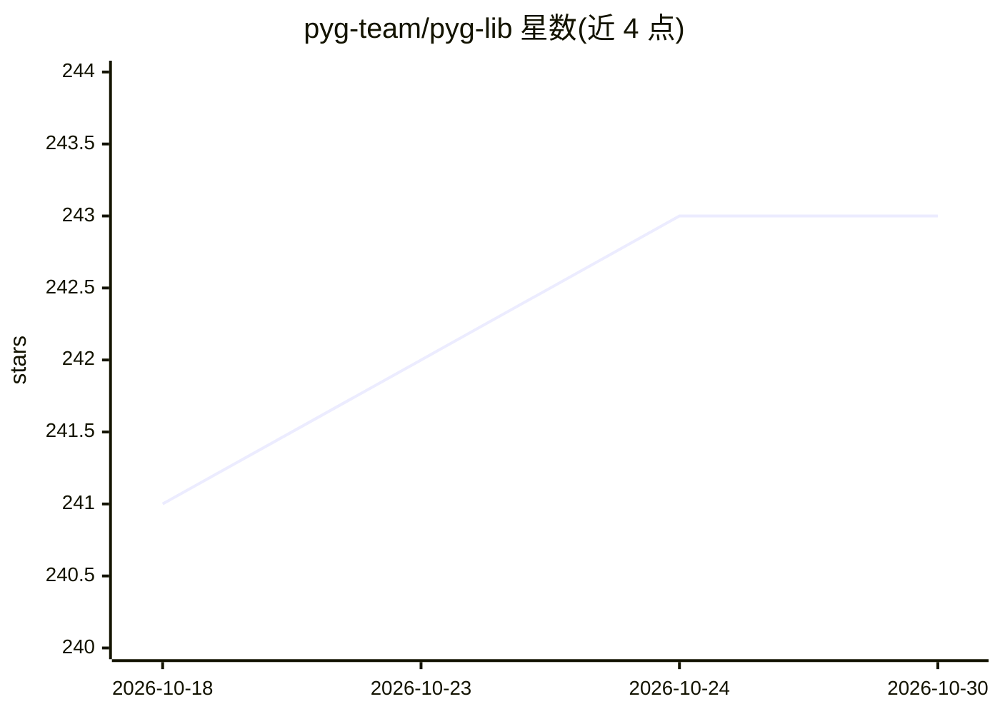

# pyg-team/pyg-lib

⭐ 243 · C++ · NOASSERTION · 推送 2026-10-28 · [GitHub](https://github.com/pyg-team/pyg-lib) · [官网](https://pyg-lib.readthedocs.io) · 组织维护

**PyG 的底层图神经网络算子库，提供高效图计算原语**

PyTorch Geometric（PyG）团队的底层算子库：为图神经网络提供低层级 C++/CUDA 实现的图操作原语，作为 PyG 生态的性能后端组件供开发者使用。安装方式包括预编译 wheel（覆盖 Linux/Windows/macOS，PyTorch 2.12–2.14，cpu/cu130/cu132，CPython 3.10–3.14）、Linux nightly wheel 及从源码编译（需 ninja/wheel）。README 仅含安装说明，未展开具体算子列表。

## 筛选速览

| 维度 | 判定 | 备注 |
|---|---|---|
| AI 角色 | `ai-ecosystem` | LLM/agent 周边工具 |
| 许可风险 | `none` | NOASSERTION |
| 部署形态 | `library` | 以包/库形式分发 |
| 模型依赖 | — | README 未给出锁定关系 |
| 硬件要求 | — | 无带数字的原话,不猜 |
| 安装摩擦 | `high` | 编译与系统依赖俱全 |
| 成熟度 | — | 结构信号不足 |

## 能力要点

- 面向 PyG 的低层级图神经网络算子库
- 预编译 wheel 覆盖主流 OS/PyTorch/CUDA 组合（CPython 3.10–3.14，stable ABI）
- 提供 nightly wheel 与源码编译两种安装途径

## 适用场景

- 为 PyG 图神经网络模型引入底层高性能算子
- 在指定 PyTorch/CUDA 版本组合下安装 PyG 官方算子库

## 场景标签

 · 领域:深度学习/图机器学习

## 证据(README 行号)

> L1: # pyg-lib
> L10: We provide pre-built Python wheels for all major OS/PyTorch/CUDA

## 星数曲线

2026-10-18 241 → 2026-10-30 243（+2）

---
*卡片 v1 · prompt 1.4 · 生成 2026-10-22 · 置信度 mid · 依据 README sha `a94ea31a963f` · [字段定义](../../DATASET.md)*
