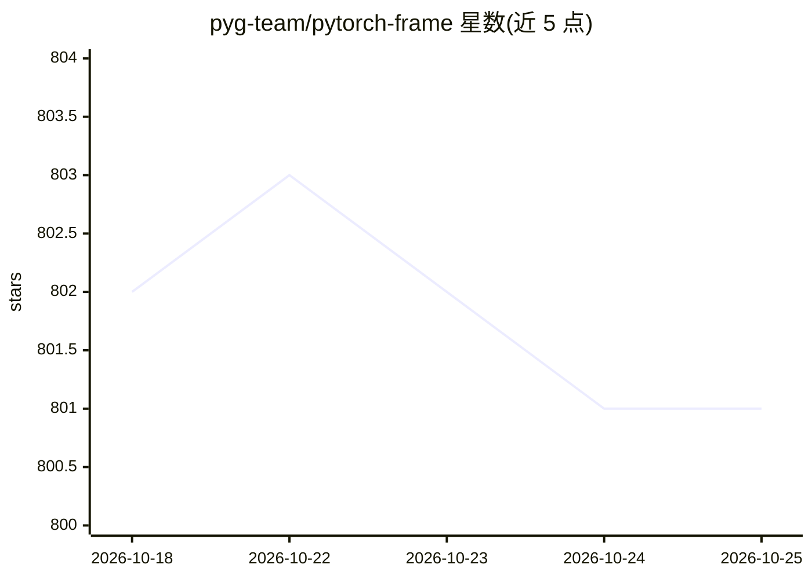

# pyg-team/pytorch-frame

⭐ 801 · Python · MIT · 推送 2026-10-05 · [GitHub](https://github.com/pyg-team/pytorch-frame) · [官网](https://pytorch-frame.readthedocs.io) · 组织维护

**面向异构表格数据的 PyTorch 深度学习框架**

基于 PyTorch 的表格深度学习库：将 pandas DataFrame 物化为 TensorFrame，通过 FeatureEncoder、TableConv、Decoder 的模块化组合训练深度表格模型，支持数值、类别、文本、时间戳、图像嵌入等多种列类型。内置 Trompt、FTTransformer、TabNet 等 6 类模型与 XGBoost/CatBoost/LightGBM 对比示例（Optuna 调参），并提供预置数据集与基准结果。文本列可通过 OpenAI、Cohere、Hugging Face、Voyage AI 嵌入 API 或本地模型编码。以 pip 包提供，支持 Python 3.10–3.14。

## 筛选速览

| 维度 | 判定 | 备注 |
|---|---|---|
| AI 角色 | `ai-native` | 本体是模型或模型工具 |
| 许可风险 | `permissive` | MIT |
| 部署形态 | `library` | 以包/库形式分发 |
| 模型依赖 | — | README 未给出锁定关系 |
| 硬件要求 | — | 无带数字的原话,不猜 |
| 安装摩擦 | `low` | 无编译、无系统依赖或容器化 |
| 成熟度 | — | 结构信号不足 |

## 能力要点

- 模块化架构：Materialization→FeatureEncoder→TableConv→Decoder
- 支持 8 种列类型（含 text_embedded、image_embedded）
- 内置 6 个深度表格模型与 GBDT 对比示例及基准
- 文本列可通过多种嵌入 API（OpenAI/Cohere/Hugging Face/Voyage）编码

## 适用场景

- 在含文本、类别、数值混合列的表格数据上训练深度模型
- 将深度表格模型与下游 PyTorch/GNN 模型端到端联训
- 对比深度表格模型与 GBDT 的表现

## 场景标签

 · 领域:表格深度学习/机器学习库

## 证据(README 行号)

> L13: PyTorch Frame is a deep learning extension for PyTorch, designed for heterogeneous tabular data with different colu
> L63: Models in PyTorch Frame follow a modular design of `FeatureEncoder`, `TableConv`, and `Decoder`, as shown in the fi
> L116: - **Trompt** from Chen *et al.*: Trompt: Towards a Better Deep Neural Network for Tabular Data (ICML 2023) \[**Exa

## 星数曲线

2026-10-18 802 → 2026-10-25 801（-1）

---
*卡片 v1 · prompt 1.4 · 生成 2026-10-21 · 置信度 high · 依据 README sha `33d436876ccf` · [字段定义](../../DATASET.md)*
