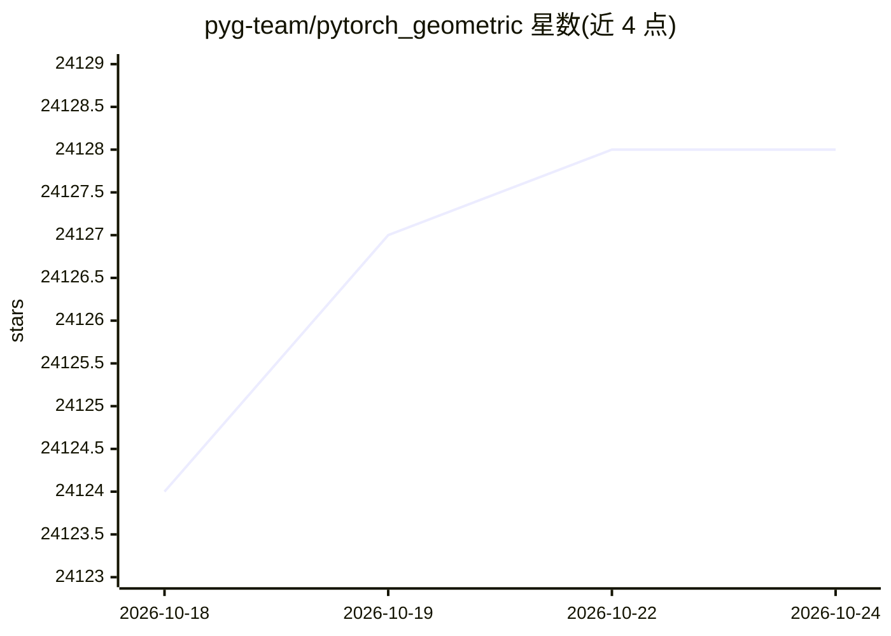

# pyg-team/pytorch_geometric

⭐ 24,129 · Python · MIT · 推送 2026-10-21 · [GitHub](https://github.com/pyg-team/pytorch_geometric) · [官网](https://pyg.org) · 组织维护

**基于 PyTorch 的图神经网络库，面向结构化数据**

构建在 PyTorch 之上的库，用于编写和训练图神经网络（GNN），覆盖结构化数据相关应用。收录来自多篇已发表论文的图与不规则结构深度学习方法（几何深度学习）；提供小图与巨型图的 mini-batch 加载器、多 GPU 支持、torch.compile 与 DataPipe 支持、常见基准数据集接口，以及面向任意图、3D 网格与点云的变换。架构分为 engine、storage、operators、models 四层，GNN 层基于 nn.MessagePassing 接口实现，面向机器学习研究者与初学者。

## 筛选速览

| 维度 | 判定 | 备注 |
|---|---|---|
| AI 角色 | `ai-ecosystem` | LLM/agent 周边工具 |
| 许可风险 | `permissive` | MIT |
| 部署形态 | `library` | 以包/库形式分发 |
| 模型依赖 | — | README 未给出锁定关系 |
| 硬件要求 | — | 无带数字的原话,不猜 |
| 安装摩擦 | `medium` | 含编译或系统依赖之一 |
| 成熟度 | — | 结构信号不足 |

## 动量与使用信号

- 维护:`active` — 距上次 push 12.3 天,年发版 2,424 位贡献者
- 涨星:近 1 天 **+1**(自 20261016 起算)
- 安装:pypi 包 `torch_geometric` 月下载 960,240

## 能力要点

- 通过 MessagePassing 接口实现数十种论文发表的 GNN 层（GCN、GAT、SAGE、GIN 等）
- 支持大规模图训练：百万级节点图、动态图、异构图，提供多种采样方案
- 多 GPU、torch.compile、TorchScript 与 DataPipe 支持
- 10-20 行代码即可完成一个 GNN 模型训练，附带 Colab 笔记本与 OGB 示例

## 适用场景

- 在引文网络等图结构数据上做节点分类等机器学习研究
- 复现或扩展论文中的图神经网络架构
- 处理 3D 网格与点云的深度学习任务
- 在异构图数据上构建预测模型

## 场景标签

 · 领域:机器学习/图深度学习

## 证据(README 行号)

> L13: **PyG** *(PyTorch Geometric)* is a library built upon PyTorch to easily write and train Graph Neural Networks (GNNs
> L84: - The PyG **engine** utilizes the powerful PyTorch deep learning framework with full `torch.compile` and TorchScrip
> L94: All Graph Neural Network layers are implemented via the **`nn.MessagePassing`** interface.

## 星数曲线

2026-10-18 24,124 → 2026-10-24 24,128（+4）

---
*卡片 v1 · prompt 1.4 · 生成 2026-10-18 · 置信度 high · 依据 README sha `2da1cea7a3dd` · [字段定义](../../DATASET.md)*
